# Chapter 1: Scale From Zero to Millions of Users

## Core Idea
Scaling is iterative: start with one server, then peel off one bottleneck at a time — split web/data tiers, add a load balancer, replicate the DB, cache, CDN, go stateless, add data centers, decouple with queues, then shard. Each step removes a single point of failure or a load ceiling.

## Frameworks Introduced
- **The Scaling Ladder** (the chapter's order of moves):
  1. Single server (web app + DB + cache on one box)
  2. Separate web tier and data tier → scale independently
  3. Load balancer + ≥2 web servers → failover for web tier
  4. Master–slave DB replication → failover + read scaling for data tier
  5. Cache tier → cut DB reads
  6. CDN → offload static assets
  7. Stateless web tier (session state in shared store) → autoscaling
  8. Multiple data centers (geoDNS) → regional availability
  9. Message queue → decouple producers/consumers
  10. Logging, metrics, automation
  11. Shard the database (+ move non-relational data to NoSQL)
- **"Millions of users" checklist** (chapter summary, exact list): keep web tier stateless · build redundancy at every tier · cache data as much as you can · support multiple data centers · host static assets in CDN · scale your data tier by sharding · split tiers into individual services · monitor your system and use automation tools.
- **Read-through cache**: web server checks cache → on miss, reads DB, stores in cache, returns.
- **Sharding by key**: `shard = hash(sharding_key) % N`; choose a key that distributes data evenly.

## Key Concepts
- **Vertical scaling (scale up)**: bigger machine. Simple; hard ceiling; no failover; expensive at the top end.
- **Horizontal scaling (scale out)**: more machines. Preferred at scale.
- **Load balancer**: public IP faces clients; talks to web servers over private IPs.
- **Master/slave replication**: writes to master, reads from slaves; usually more slaves than masters (read-heavy workloads).
- **SPOF**: a component whose failure stops the entire system.
- **CDN**: geo-dispersed servers caching static content; origin fetch on miss; TTL header controls lifetime.
- **Stateless web tier**: no session state on web servers; any server can handle any request.
- **geoDNS**: resolves domain to the nearest data center by user location.
- **Message queue**: durable buffer for async communication between producers and consumers.
- **Sharding key / partition key**: column(s) that decide which shard holds a row.
- **Celebrity (hotspot key) problem**: one shard overloaded by a few hot keys.

## Mental Models
- Think of every tier as needing **redundancy** — after adding one, ask "what if this goes offline?"
- Use a **cache** when data is read frequently but modified infrequently; never as the only copy of important data.
- Think of **state** as the thing that blocks horizontal scaling — move it out of the web tier first.
- Use a **message queue** when work is slow (photo processing) or producer/consumer need to scale/fail independently; scale workers off queue depth.

## Anti-patterns
- **Sticky sessions / stateful servers**: every request from a client must hit the same server; adding/removing servers and handling failures become hard.
- **Single cache server**: SPOF — run multiple across data centers and over-provision memory.
- **No cache expiry**: stale data lives forever; **too short** an expiry hammers the DB.
- **Caching rarely used assets on a CDN**: costs transfer fees with no benefit.
- **Cross-shard joins**: hard after sharding; de-normalize instead.
- **Uneven sharding key**: causes shard exhaustion → painful resharding.

## Code Examples
```python
# Typical Memcached API
SECONDS = 1
cache.set('myKey', 'hi there', 3600 * SECONDS)
cache.get('myKey')
```
- **What it demonstrates**: cache servers expose simple get/set with a TTL.

```json
// GET /users/12 — JSON API response (mobile traffic source)
{ "id": 12, "firstName": "John", "lastName": "Smith",
  "address": { "streetAddress": "21 2nd Street", "city": "New York", "state": "NY", "postalCode": 10021 },
  "phoneNumbers": ["212 555-1234", "646 555-4567"] }
```

## Reference Tables

| Choose NoSQL if… | Otherwise default to relational (40+ yrs proven, joins) |
|---|---|
| super-low latency needed | |
| data is unstructured / non-relational | |
| you only serialize/deserialize (JSON, XML, YAML) | |
| you must store a massive amount of data | |

| Cache consideration | Rule |
|---|---|
| When to use | read-heavy, infrequently modified data |
| Expiration | always set one; not too short, not too long |
| Consistency | DB + cache writes aren't one transaction; hard across regions (see "Scaling Memcache at Facebook") |
| Failure | avoid SPOF: multiple cache servers across DCs; over-provision memory |
| Eviction | LRU most popular; LFU, FIFO for other cases |

| CDN consideration | Rule |
|---|---|
| Cost | move infrequently used assets out |
| Expiry | time-sensitive content needs a balanced TTL |
| Fallback | clients detect CDN outage and fetch from origin |
| Invalidation | vendor API, or object versioning (`image.png?v=2`) |

| Multi-DC challenge | Approach |
|---|---|
| Traffic redirection | geoDNS to nearest DC |
| Data synchronization | replicate data across DCs (Netflix async multi-DC replication) |
| Test & deployment | test from multiple locations; automated deploys keep DCs consistent |

| Sharding challenge | Fix |
|---|---|
| Resharding (growth, uneven distribution → shard exhaustion) | consistent hashing (Ch 5) |
| Celebrity / hotspot key | dedicated shard per celebrity, possibly further partitioned |
| Join & de-normalization | de-normalize so queries hit one table |

## Diagrams

**Fig 1-1/1-2 — Single server request flow**
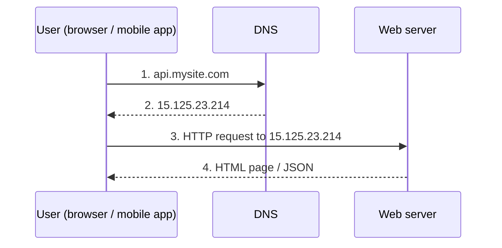

**Fig 1-3 — Web tier separated from data tier**
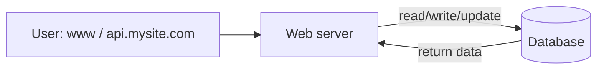

**Fig 1-4 — Load balancer**
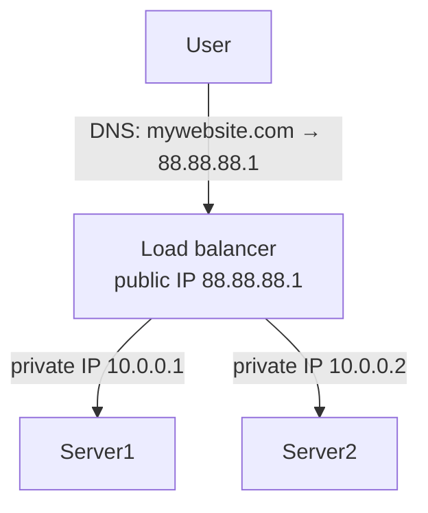

**Fig 1-5 — Master/slave replication**
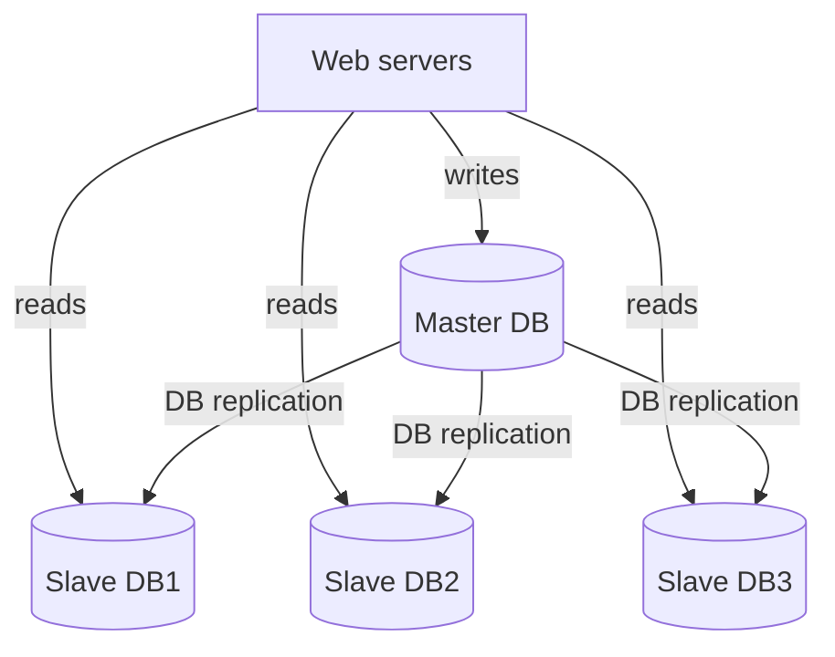

**Fig 1-6 — LB + replication**
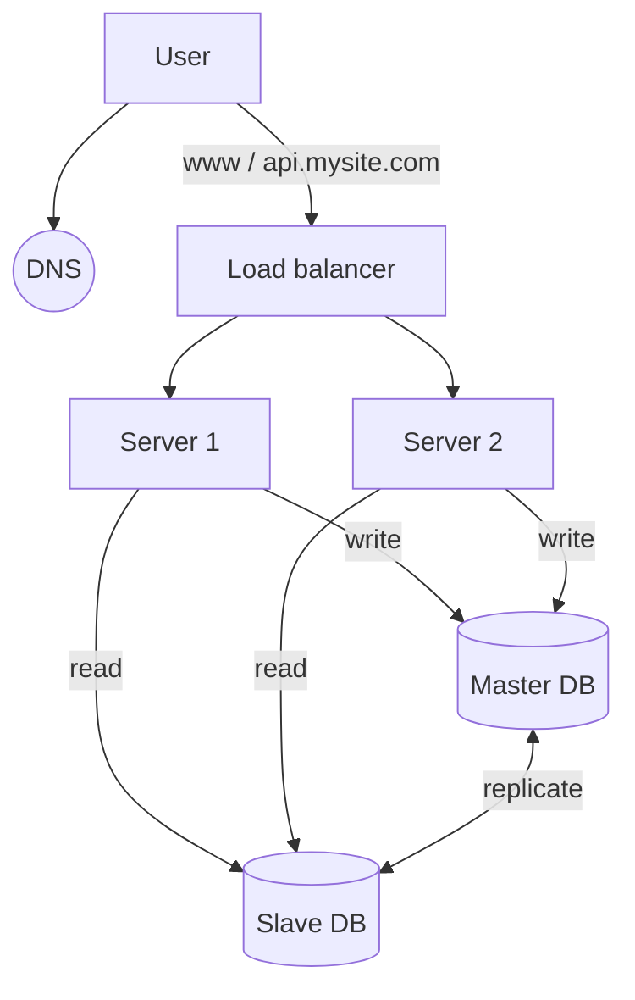

**Fig 1-7 — Read-through cache**
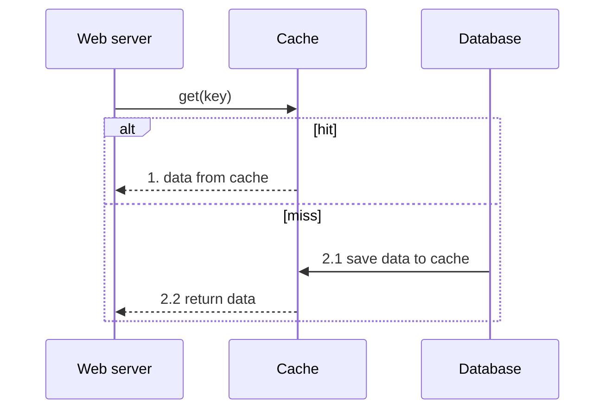

**Fig 1-8 — SPOF**: three clients all connect through one router to an app server; the router is the single point of failure.

**Fig 1-9 — CDN latency**: client → origin = 120 ms; client → nearby CDN edge = 40 ms (CDN pulls the image from origin once).

**Fig 1-10 — CDN workflow**
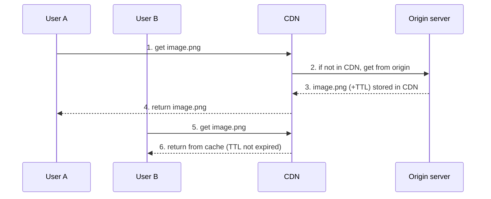

**Fig 1-11 — With CDN + cache**: Fig 1-6 plus ① CDN serving static assets directly to users and ② a cache tier that web servers hit before the DB.

**Fig 1-12 vs 1-13 — Stateful vs stateless**
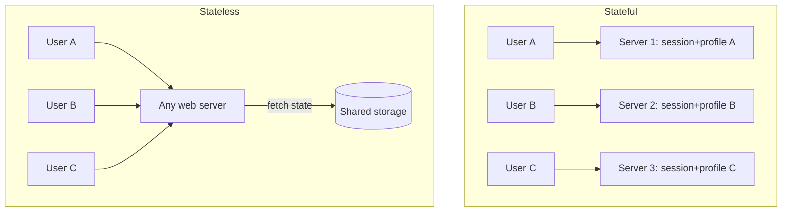

**Fig 1-14 — Stateless web tier**: LB → ① autoscaled Server1..4 → master DB + 2 slaves, cache, and NoSQL (session store). DNS + CDN at the edge.

**Fig 1-15/1-16 — Two data centers**
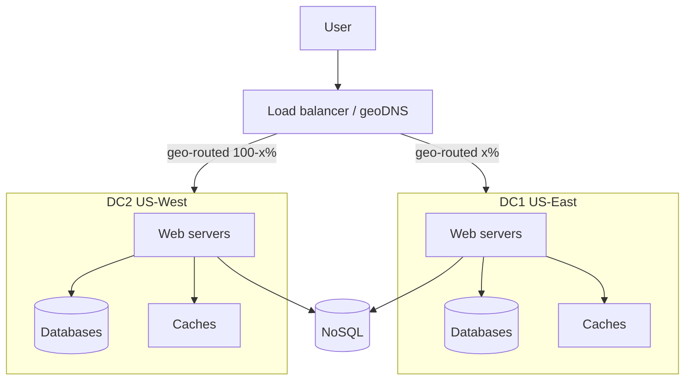
Fig 1-16: DC2 offline → 100% traffic to DC1.

**Fig 1-17/1-18 — Message queue**
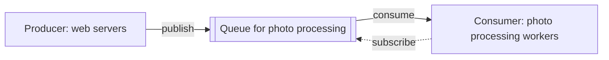

**Fig 1-19 — Queue + tools**: DC1 holds web servers → databases, caches, ① message queue → workers; NoSQL outside; ② tools (logging, metrics, monitoring, automation) watch the DC.

**Fig 1-20 — Vertical vs horizontal**: vertical = one ever-bigger server (more CPU/RAM/disk); horizontal = many equal servers.

**Fig 1-21/1-22 — Sharding by `user_id % 4`**

| Shard 0 | Shard 1 | Shard 2 | Shard 3 |
|---|---|---|---|
| 0, 4, 8, 12… | 1, 5, 9, 13… | 2, 6, 10, 14… | 3, 7, 11, 15… |

**Fig 1-23 — Final design**
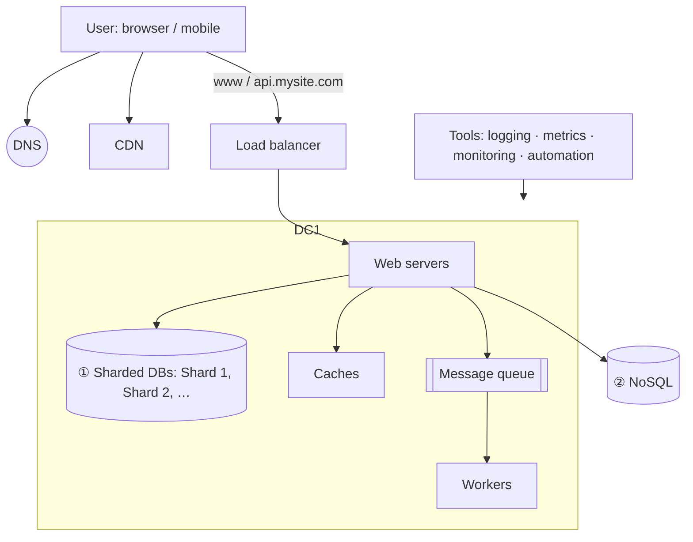

## Worked Example
Walking the photo-customization use case: web servers publish crop/sharpen/blur jobs to a queue; photo workers consume asynchronously. Queue grows → add workers; queue mostly empty → remove workers. Producer can post while consumers are down and vice versa — the decoupling is the point.

Failover walk-through (Fig 1-6): one slave down → reads go to other slaves (or master temporarily) while a replacement is provisioned. Master down → promote a slave; in production the promoted slave may be stale, so run data-recovery scripts (multi-master/circular replication exist but are out of scope).

## Key Takeaways
1. Remove SPOFs tier by tier: LB for web, replication for DB, multiple cache nodes, multiple DCs.
2. Go stateless before you autoscale — session data belongs in a shared store (NoSQL is easy to scale).
3. Cache read-heavy data with an expiry policy and an eviction policy (LRU by default).
4. Put static assets on a CDN; plan for CDN fallback and invalidation via versioned URLs.
5. Shard last; choose an even-distributing key and expect resharding, hotspots, and lost joins.
6. Once big, logging/metrics (host, aggregated, business) and CI/automation are mandatory.

## Connects To
- **Ch 5**: consistent hashing solves resharding and hotspot redistribution.
- **Ch 6**: replication + quorum generalize master/slave.
- **Ch 2**: estimation decides when each ladder step is needed.
- **Every design chapter (4, 8–15)**: reuses LB → stateless web tier → cache → DB/queue as its skeleton.
