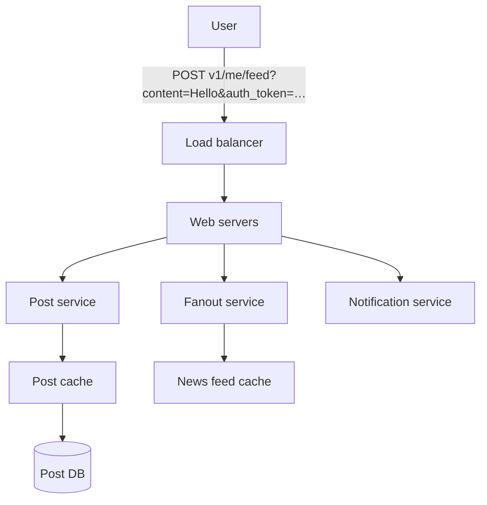
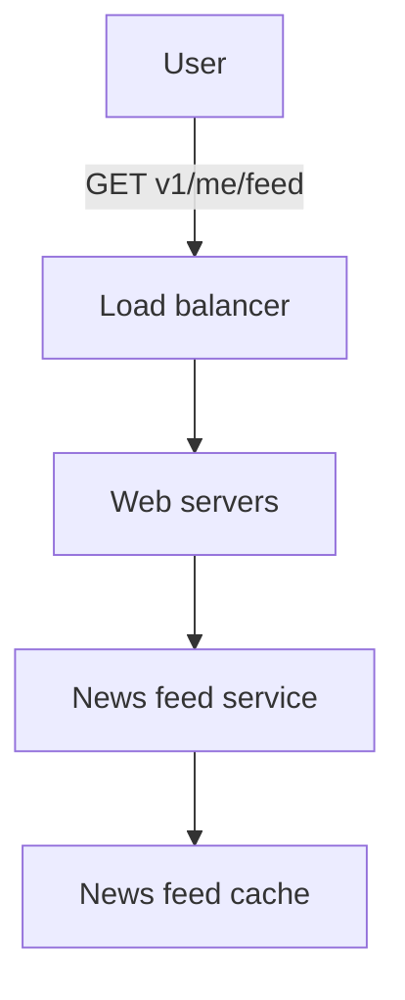
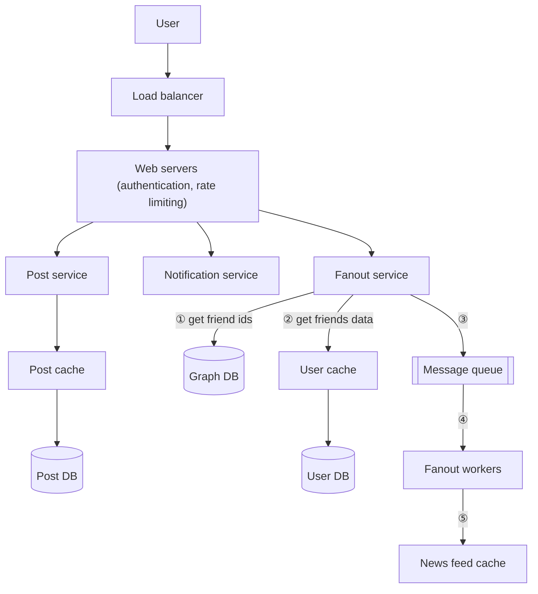
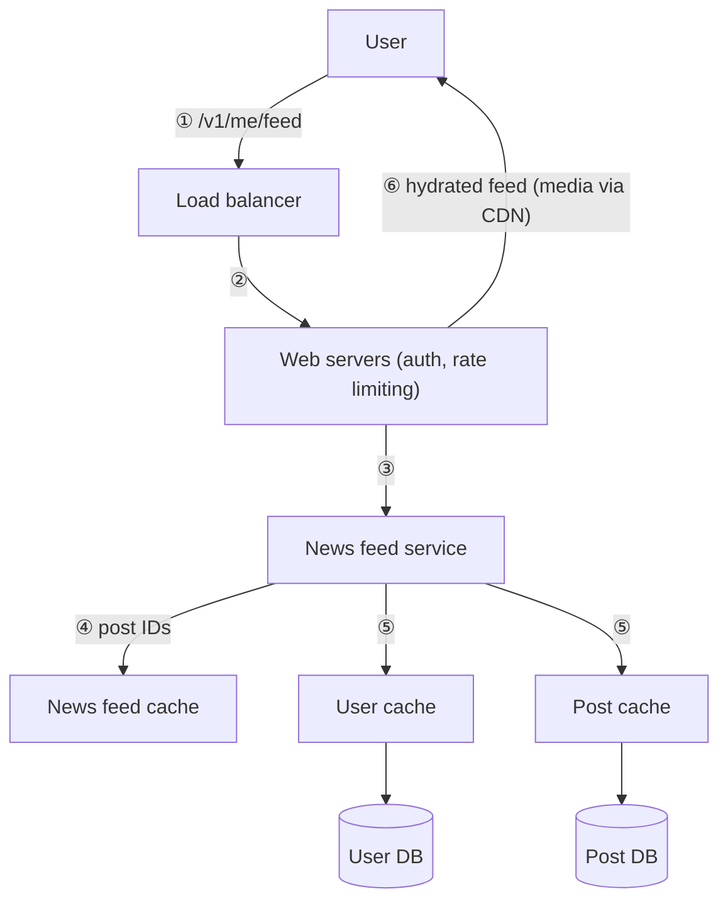

# Chapter 3: A Framework for System Design Interviews

## Core Idea
A system design interview simulates two co-workers collaborating on an ambiguous problem. The final design matters less than the process: clarify, propose and get buy-in, deep dive where the interviewer cares, then wrap up with bottlenecks and improvements.

## Frameworks Introduced
- **The 4-Step Process** (with time budget for a 45-min session):
  1. **Understand the problem and establish design scope** (3–10 min) — ask, don't answer. "DON'T be like Jimmy."
  2. **Propose high-level design and get buy-in** (10–15 min) — box diagram, back-of-envelope check, walk concrete use cases, treat interviewer as teammate.
  3. **Design deep dive** (10–25 min) — prioritize components with the interviewer; go deep where the signal is.
  4. **Wrap up** (3–5 min) — bottlenecks, recap, error cases, operations, next scale curve, refinements.
- **Step 1 starter questions**: What specific features? How many users? Scale in 3 / 6 / 12 months? Tech stack and existing services to leverage?
- **Step 4 directions**: never claim the design is perfect · recap if you offered several solutions · error cases (server failure, network loss) · operations (metrics, logs, rollout) · next scale curve (1 M → 10 M users) · refinements given more time.

## Key Concepts
- **Signals interviewers look for**: collaboration, working under pressure, resolving ambiguity constructively, asking good questions.
- **Red flags**: over-engineering (design purity over trade-offs), narrow-mindedness, stubbornness.
- **Buy-in**: explicit agreement on the blueprint before going deeper.
- **Deep-dive focus** varies: URL shortener → hash function; chat → latency and online/offline status; senior candidates → bottlenecks and resource estimates.

## Mental Models
- Think of the interviewer as a **teammate**, not an examiner.
- Use concrete **use cases** to frame the high-level design and surface edge cases.
- Include API endpoints and DB schema only when the problem's granularity calls for it (poker backend yes; "design Google search" too low-level).
- Spend time only on details that **demonstrate design ability** (not, e.g., EdgeRank internals).

## Anti-patterns
- **Answering fast without understanding requirements** — huge red flag; it's not a trivia contest.
- **Over-engineering** — ignoring compounding costs of complex designs.
- **Going deep on one component too early** — give the high level first.
- **Thinking in silence** — communicate continuously.
- **Assuming you're done when the design is drawn** — you're done when the interviewer says so.

## Reference Tables

| Dos | Don'ts |
|---|---|
| Always ask for clarification | Be unprepared for typical questions |
| Understand the requirements | Jump into a solution before clarifying |
| No right/best answer — startup ≠ established company | Go into too much detail on one component early |
| Let the interviewer know what you're thinking | Hesitate to ask for hints when stuck |
| Suggest multiple approaches | Think in silence |
| Design the most critical components first | Consider yourself done once the design is given |
| Bounce ideas off the interviewer; never give up | |

## Diagrams

**Fig 3-1 — High-level feed publishing**

**Fig 3-2 — High-level news feed building**

**Fig 3-3 — Deep dive: feed publishing**

**Fig 3-4 — Deep dive: news feed retrieval**

## Worked Example
**Step 1 for "design a news feed"** — the clarifying dialogue:
- Mobile, web, or both? → Both.
- Most important features? → Make a post; see friends' news feed.
- Ordering? → Reverse chronological (not weighted ranking) to keep it simple.
- Max friends? → 5,000.
- Traffic? → 10 M DAU.
- Media? → Images and videos.

**Step 2**: split into two flows — feed publishing (write post to cache/DB, populate friends' feeds) and news feed building (aggregate friends' posts reverse-chronologically) → Fig 3-1 / 3-2.
**Step 3**: deep dive the two most important use cases → Fig 3-3 / 3-4 (full detail in Ch 11).

## Key Takeaways
1. Clarify first: features, users, growth, existing stack. Write assumptions down.
2. Get explicit buy-in on the blueprint before going deep.
3. Let the interviewer steer the deep dive; manage time ruthlessly.
4. In wrap-up, volunteer bottlenecks and the next scale curve — never say "it's perfect".
5. Over-engineering is a red flag; trade-offs are the signal.

## Connects To
- **Ch 2**: estimation is part of Step 2.
- **Ch 4–15**: every design chapter is structured as Steps 1–4.
- **Ch 11**: full news feed design used as this chapter's example.
