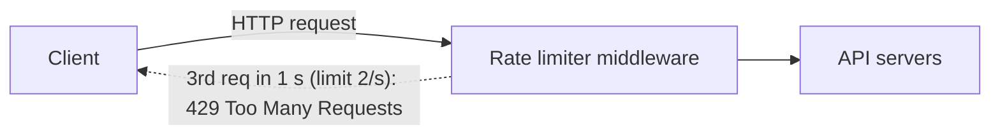
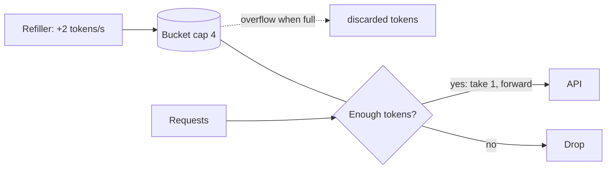
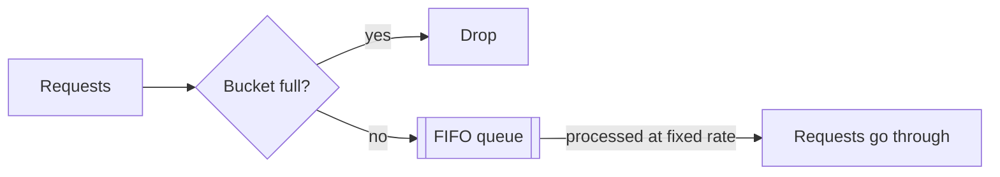
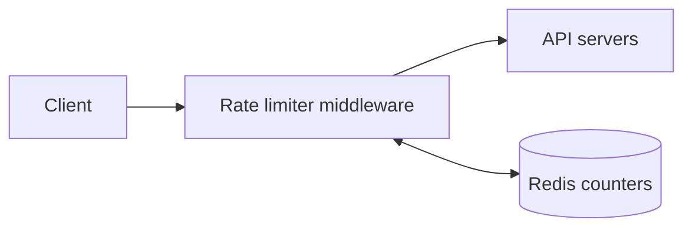
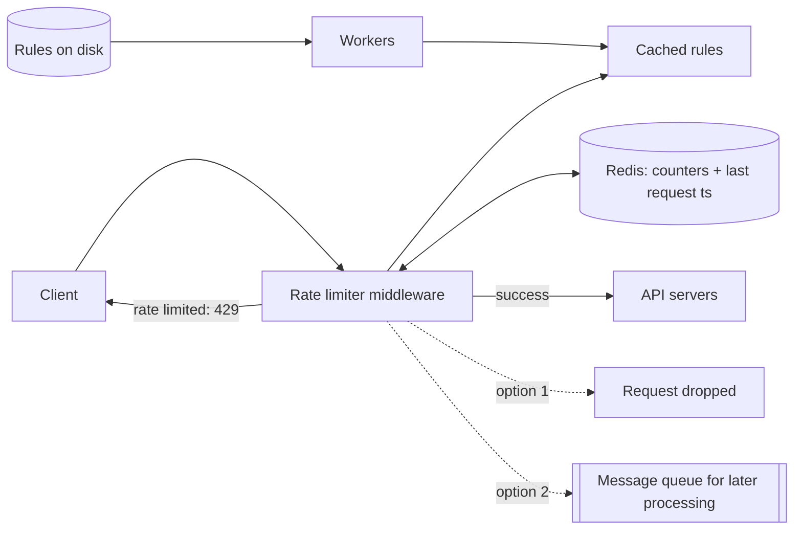
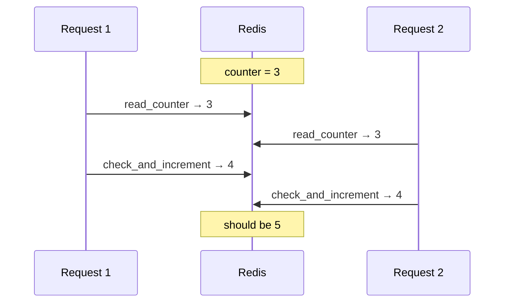

# Chapter 4: Design a Rate Limiter

## Core Idea
A server-side rate limiter (usually middleware / API gateway) keeps per-key counters in an in-memory store (Redis), rejects excess requests with HTTP 429, and must stay correct under concurrency and across many limiter instances. Pick the algorithm by how strictly you need to bound bursts versus how much memory you can spend.

## Frameworks Introduced
- **Five rate-limiting algorithms** (exact names): Token bucket · Leaking bucket · Fixed window counter · Sliding window log · Sliding window counter.
- **Where to put it** (guidelines): evaluate your stack (is your language efficient enough server-side?) · pick the algorithm you need (third-party gateway may limit choice) · if you already run an API gateway for auth/IP whitelisting, add rate limiting there · short on engineering resources → commercial API gateway.
- **Rule format (Lyft ratelimit)**: domain + descriptors (key/value) + `rate_limit {unit, requests_per_unit}`; stored in config files on disk, pulled into cache by workers.
- **Distributed challenges**: race condition (fix: Lua script or Redis sorted sets, not locks) and synchronization (fix: centralized Redis, not sticky sessions).

## Key Concepts
- **HTTP 429 Too Many Requests**: response for throttled calls.
- **X-Ratelimit-Remaining / X-Ratelimit-Limit / X-Ratelimit-Retry-After**: headers telling clients their remaining quota, window limit, and wait time.
- **Bucket size / refill rate** (token bucket); **bucket size (queue size) / outflow rate** (leaking bucket).
- **Redis INCR / EXPIRE**: atomic increment; auto-delete counter after timeout.
- **Hard vs soft rate limiting**: hard never exceeds threshold; soft may exceed briefly.
- **Layer 7 vs Layer 3 limiting**: HTTP-level vs IP-level (iptables).

## Mental Models
- Use **token bucket** when you must allow short bursts (flash sales) — Amazon, Stripe.
- Use **leaking bucket** when downstream needs a stable outflow rate — Shopify.
- Use **sliding window log** when accuracy must be exact in every rolling window and memory is cheap.
- Use **sliding window counter** as the pragmatic default: smooth, memory-cheap, ~accurate (Cloudflare: 0.003% wrong of 400 M requests).
- Think of one bucket **per rule per key**: 3 per-user rules → 3 buckets per user; per-IP limit → one bucket per IP; global 10k RPS → one shared bucket.

## Anti-patterns
- **Client-side enforcement**: forgeable, and you may not control the client.
- **Counters in a database**: disk is too slow.
- **Locks for the race condition**: correct but slow.
- **Sticky sessions for synchronization**: neither scalable nor flexible.
- **Fixed window with burst at edges**: lets up to 2× quota through.
- **Single-region limiter**: far users pay latency — use edge servers + eventual consistency sync.

## Code Examples
```yaml
# Lyft rule: max 5 marketing messages per day
domain: messaging
descriptors:
  - key: message_type
    value: marketing
    rate_limit:
      unit: day
      requests_per_unit: 5
---
# Max 5 logins per minute
domain: auth
descriptors:
  - key: auth_type
    value: login
    rate_limit:
      unit: minute
      requests_per_unit: 5
```

```text
# Sliding window counter
requests_in_rolling_window = current_window_count + previous_window_count × overlap%
```

## Reference Tables

| Algorithm | How | Pros | Cons |
|---|---|---|---|
| Token bucket | Refiller adds tokens at a fixed rate up to capacity; each request takes one; none left → drop | Easy, memory-efficient, allows short bursts | Tuning bucket size + refill rate is hard |
| Leaking bucket | FIFO queue; full → drop; drained at fixed rate | Memory-efficient; stable outflow | Burst fills queue with old requests, starving new ones; 2 params to tune |
| Fixed window counter | Counter per fixed window; reset at window start | Memory-efficient, simple, fits "quota resets at X" | Spikes at window edges pass up to 2× quota |
| Sliding window log | Store timestamps (Redis sorted set); drop outdated; accept if log size ≤ limit | Very accurate in any rolling window | Memory-heavy (rejected timestamps also stored) |
| Sliding window counter | Current count + previous count × overlap % | Smooths spikes; memory-efficient | Approximation; assumes previous window was uniform |

| Requirement | Design response |
|---|---|
| Accurate limiting | algorithm choice + atomic counters |
| Low latency | in-memory Redis, edge servers |
| Little memory | counter-based algorithms |
| Distributed | centralized Redis |
| Exception handling | 429 + rate-limit headers |
| Fault tolerance | limiter failure must not take down the system |

## Diagrams

**Fig 4-1/4-2/4-3 — Placement and throttling**

Fig 4-1 shows the alternative: limiter embedded inside the API servers.

**Fig 4-4/4-5 — Token bucket**


**Fig 4-6 — Token bucket timeline (size 4, refill 4/min)**

| Time | Tokens at start | Requests | Result |
|---|---|---|---|
| 1:00:00 | 4 | 1 | passes, 3 left |
| 1:00:05 | 3 | 3 | all pass, 0 left |
| 1:00:20 | 0 | 1 | dropped |
| 1:01:00 | refilled to 4 | — | — |

**Fig 4-7 — Leaking bucket**


**Fig 4-8 — Fixed window (3 req/s)**: per-second bars at 1:00:00–1:00:04; anything above 3 in a second is greyed out (rate limited).

**Fig 4-9 — Edge burst**: limit 5/min; 5 requests in 2:00:30–2:01:00 and 5 in 2:01:00–2:01:30 → 10 requests in the rolling minute 2:00:30–2:01:30.

**Fig 4-10 — Sliding window log (2 req/min)**

| Arrives | Log after insert/cleanup | Size | Result |
|---|---|---|---|
| 1:00:01 | [1:00:01] | 1 | ✅ |
| 1:00:30 | [1:00:01, 1:00:30] | 2 | ✅ |
| 1:00:50 | [1:00:01, 1:00:30, 1:00:50] | 3 | ❌ (timestamp still kept) |
| 1:01:40 | remove < 1:00:40 → [1:00:50, 1:01:40] | 2 | ✅ |

**Fig 4-11 — Sliding window counter**: rolling minute = 70% of previous minute + 30% of current minute. (Figure labels the limit 5/min; text example uses 7/min.)

**Fig 4-12 — High-level**


**Fig 4-13 — Detailed design**


**Fig 4-14 — Race condition**


**Fig 4-15/4-16 — Synchronization**: stateless web tier means client 1 may hit limiter 1 then limiter 2; without shared state each limiter sees partial counts → both limiters read/write a centralized Redis.

**Fig 4-17 — Edge servers**: a user is routed to the nearest of many geographically distributed edge servers (Cloudflare had 194 in 2020).

## Worked Example
**Sliding window counter calculation**: limit 7/min; previous minute had 5 requests; current minute has 3; new request arrives 30% into the current minute.
- Rolling count = 3 + 5 × 70% = 6.5 → round down → 6.
- 6 < 7 → request allowed; the next one will hit the limit.

**Step 1 dialogue outcome** — requirements: server-side API limiter · flexible throttle rules (IP, user ID, …) · large scale · distributed · design choice whether separate service · inform throttled users. Non-functional: accurate, low latency, low memory, distributed, clear exceptions, high fault tolerance.

## Key Takeaways
1. Put limiting server-side — middleware or API gateway — never trust the client.
2. Store counters in Redis (INCR + EXPIRE); rules in config, cached by workers.
3. Return 429 + X-Ratelimit-* headers; optionally queue throttled work (e.g., orders) for later.
4. Solve races with Lua scripts / sorted sets; solve multi-instance sync with centralized Redis.
5. Monitor both algorithm and rules: too strict → valid traffic dropped; flash-sale bursts → switch to token bucket.
6. Client best practices: cache responses, respect limits, catch errors, back off on retry.

## Connects To
- **Ch 1**: stateless web tier is why limiters need shared state.
- **Ch 6**: eventual consistency model for cross-DC limiter sync.
- **Ch 10**: notification system applies rate limiting per user.
- **OSI model**: L7 (HTTP) vs L3 (iptables) limiting.
