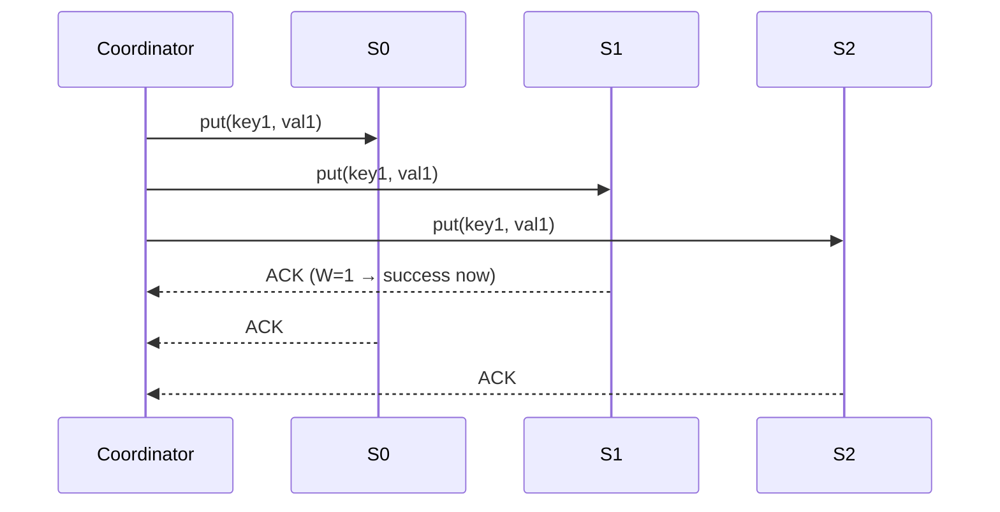
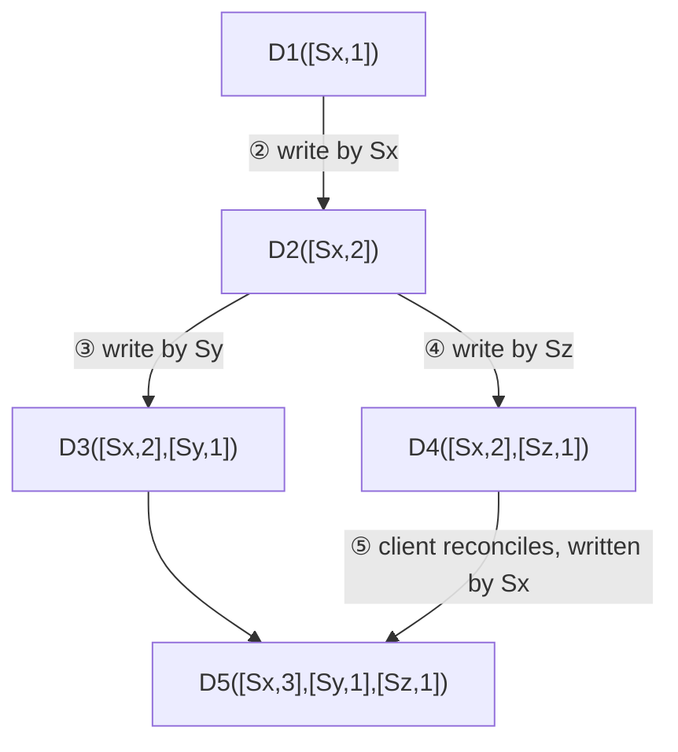
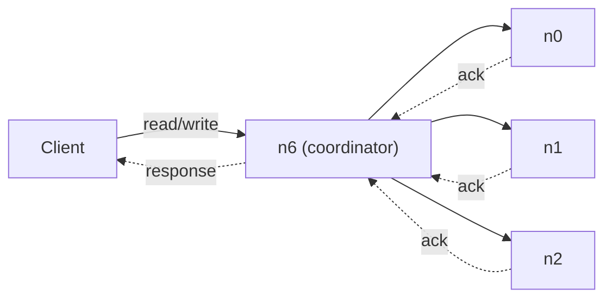
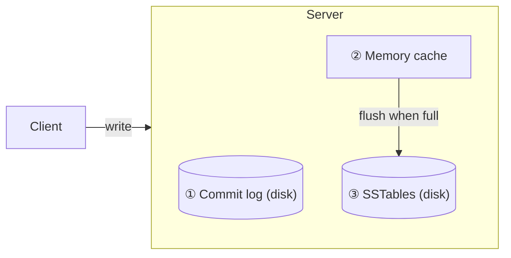
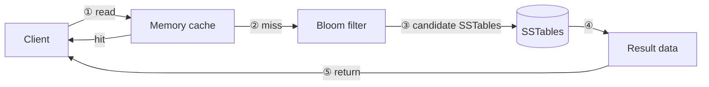

# Chapter 6: Design a Key-Value Store

## Core Idea
A distributed key-value store (Dynamo / Cassandra / BigTable lineage) is built from a small set of composable techniques: consistent hashing for partitioning, N-way replication on the ring, tunable quorums (N/W/R), vector clocks for conflict detection, gossip for failure detection, sloppy quorum + hinted handoff for temporary failures, Merkle-tree anti-entropy for permanent ones, and an LSM-style commit log → memtable → SSTable storage engine with Bloom filters on reads.

## Frameworks Introduced
- **CAP theorem**: of Consistency, Availability, Partition tolerance, a distributed system can guarantee at most two. Partitions are unavoidable → real choice is **CP vs AP**; CA cannot exist in practice.
- **Quorum consensus (N, W, R)**:
  - N = replicas; W = acks needed for a write; R = responses needed for a read.
  - `W + R > N` → strong consistency (overlap guarantees a fresh replica). Typical: N=3, W=R=2.
  - `R = 1, W = N` → fast reads. `W = 1, R = N` → fast writes. `W + R ≤ N` → no strong consistency.
- **Vector clock** `D([S1,v1], …, [Sn,vn])`: on write to Si, increment vi if present, else add [Si,1].
  - X is an **ancestor** of Y if every counter in Y ≥ X's → no conflict.
  - X and Y are **siblings** (conflict) if any counter in Y is less than in X.
- **Failure handling ladder**: detect (gossip) → temporary (sloppy quorum + hinted handoff) → permanent (anti-entropy with Merkle trees) → DC outage (cross-DC replication).
- **Merkle tree build** (4 steps): divide key space into buckets → hash each key → one hash per bucket → hash upward to root. Compare roots; descend only into mismatched children.

## Key Concepts
- **Coordinator**: node proxying client requests to replicas.
- **Replica placement**: walk clockwise, choose first N **unique physical** servers (skip vnodes of the same server); spread across data centers.
- **Heterogeneity**: give bigger servers more virtual nodes.
- **Strong / weak / eventual consistency**: always latest · may be stale · converges given time (Dynamo, Cassandra — recommended here).
- **Gossip protocol**: membership list of (member ID, heartbeat counter); bump own counter; send to random peers; a member whose counter stalls past a threshold is marked offline (needs ≥2 independent sources).
- **Sloppy quorum**: use first W/R *healthy* servers on the ring instead of strict owners.
- **Hinted handoff**: stand-in node holds writes for a down node and hands them back on recovery.
- **SSTable**: sorted list of <key, value> pairs on disk.
- **Bloom filter**: tells which SSTables *might* contain a key.

## Mental Models
- Pick CP when stale data is unacceptable (bank balance → return error during partition); pick AP when you'd rather serve possibly-stale data and sync later.
- Think of N/W/R as a **latency ↔ consistency dial**: W or R = 1 returns on the fastest replica; > 1 waits for the slowest.
- Merkle trees make sync cost **proportional to differences**, not data size (e.g., 1 M buckets for 1 B keys → 1,000 keys/bucket).
- Decentralized: every node runs the same roles → no SPOF, automatic add/remove.

## Anti-patterns
- **Trusting one node's claim that another is down**.
- **All-to-all multicast heartbeats** — O(n²), inefficient at scale.
- **Strict quorum during failures** — blocks reads/writes; use sloppy quorum.
- **Unbounded vector clocks** — cap length and drop oldest pairs (Dynamo never hit the downside in production).
- **Replicas in one data center** — correlated failures (power, network, disasters).

## Reference Tables

**Table 6-2 — Goal → technique**

| Goal / problem | Technique |
|---|---|
| Store big data | Consistent hashing spreads load |
| High-availability reads | Data replication; multi-DC setup |
| Highly available writes | Versioning + conflict resolution with vector clocks |
| Dataset partition | Consistent hashing |
| Incremental scalability | Consistent hashing |
| Heterogeneity | Consistent hashing (vnodes ∝ capacity) |
| Tunable consistency | Quorum consensus |
| Temporary failures | Sloppy quorum + hinted handoff |
| Permanent failures | Merkle tree (anti-entropy) |
| Data center outage | Cross-DC replication |

**Design scope**: KV pair < 10 KB · store big data · high availability · high scalability · automatic scaling · tunable consistency · low latency. API: `put(key, value)`, `get(key)`. Table 6-1 sample: 145→john, 147→bob, 160→Julia.

## Diagrams

**Fig 6-1 — CAP**: three overlapping circles; overlaps labeled CA, CP, AP.

**Fig 6-2/6-3 — Partition**: replicas n1, n2, n3 fully connected; n3 fails → writes to n1/n2 can't reach n3 (and n3-only writes leave n1/n2 stale) → choose block (CP) or accept-and-sync-later (AP).

**Fig 6-4/6-5 — Partition and replicate on the ring** (s0…s7 clockwise): key0 sits between s0 and s1 → stored on s1; with N=3 replicated on s1, s2, s3.

**Fig 6-6 — Quorum write (N=3)**


**Fig 6-7/6-8 — How conflicts arise**: n1 and n2 both hold name=john; server 1 writes "johnSanFrancisco" to n1 while server 2 writes "johnNewYork" to n2 → conflicting versions v1, v2.

**Fig 6-9 — Vector clocks**


**Fig 6-10 — All-to-all multicast**: s0–s3 each send heartbeats to every other node (n² arrows).

**Fig 6-11 — Gossip**: s0's membership list

| Member | Heartbeat | Time |
|---|---|---|
| 0 | 10232 | 12:00:01 |
| 1 | 10224 | 12:00:10 |
| **2** | **9908** | **11:58:02** (stale) |
| 3 | 10237 | 12:00:20 |
| 4 | 10234 | 12:00:34 |

s0 gossips s2's staleness to s1, s3 → s3 to s4, s5; once confirmed, s2 is marked down cluster-wide.

**Fig 6-12 — Sloppy quorum + hinted handoff**: coordinator writes to s0, s1 (ACK) and s2 (✗ down) → s3 takes s2's write temporarily and hands it back when s2 recovers.

**Fig 6-13 to 6-16 — Merkle tree (keys 1–12, key 8 differs)**
```text
Buckets:     [1,2,3]   [5,6]   [7,8,9]    [10,11,12]
Bucket hash:  6901      6773    8601|7975   7812        (server1|server2)
Level 2:        3545              4603|2960
Root:                  5357|9213
Compare roots ≠ → left child 3545 = 3545 ✓ → right child differs → bucket 3 differs → sync bucket [7,8,9] only
```

**Fig 6-17 — Architecture**

Ring: n0…n7; replicas for this key are n0, n1, n2.

**Fig 6-18 — Every node's roles**: client API · failure detection · conflict resolution · failure repair mechanism · replication · storage engine · …

**Fig 6-19 — Write path (Cassandra-style)**


**Fig 6-20/6-21 — Read path**


## Worked Example
**Vector clock conflict walk-through** (Fig 6-9):
1. Client writes D1 via Sx → `D1([Sx,1])`.
2. Client reads D1, writes D2 via Sx → `D2([Sx,2])` overwrites D1 (descendant).
3. Client reads D2, writes D3 via Sy → `D3([Sx,2],[Sy,1])`.
4. Another client reads D2, writes D4 via Sz → `D4([Sx,2],[Sz,1])`.
5. A reader sees D3 and D4: neither dominates (Sy only in D3, Sz only in D4) → siblings → client reconciles, writes via Sx → `D5([Sx,3],[Sy,1],[Sz,1])`.

Quick check: `D([s0,1],[s1,1])` is an ancestor of `D([s0,1],[s1,2])`; `D([s0,1],[s1,2])` vs `D([s0,2],[s1,1])` conflict.

## Key Takeaways
1. Start with the CAP choice; it drives everything after.
2. Partition with consistent hashing; replicate to the next N unique servers, across DCs.
3. Tune N/W/R; `W + R > N` for strong consistency, otherwise eventual.
4. Detect conflicts with vector clocks; push resolution to clients.
5. Gossip for detection; sloppy quorum + hinted handoff for transient faults; Merkle trees for repair.
6. Writes: commit log → memtable → flush to SSTable. Reads: memtable → Bloom filter → SSTables.

## Connects To
- **Ch 5**: consistent hashing and virtual nodes.
- **Ch 4**: eventual consistency model for multi-DC rate limiter sync.
- **Ch 12**: chat stores messages in a KV store (HBase/Cassandra).
- **Dynamo, Cassandra, BigTable papers**: source designs.
