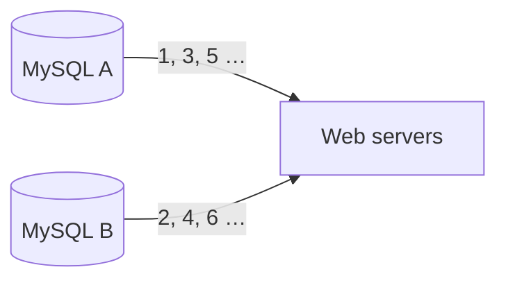

# Chapter 7: Design a Unique ID Generator in Distributed Systems

## Core Idea
`auto_increment` on one database doesn't scale. For unique, numeric, 64-bit, time-sortable IDs at 10k+/s, use a **Twitter snowflake**-style generator: divide the 64-bit ID into sign | timestamp | datacenter | machine | sequence, so every machine generates IDs independently with no coordination.

## Frameworks Introduced
- **Four candidate approaches**: multi-master replication · UUID · ticket server · Twitter snowflake.
- **Snowflake 64-bit layout** — "divide and conquer":

| Section | Bits | Meaning |
|---|---|---|
| Sign | 1 | always 0; reserved |
| Timestamp | 41 | ms since epoch (Twitter default 1288834974657 = Nov 04 2010 01:42:54 UTC) |
| Datacenter ID | 5 | 2⁵ = 32 datacenters |
| Machine ID | 5 | 32 machines per datacenter |
| Sequence number | 12 | per-machine counter, reset to 0 every ms → 4,096 IDs/ms/machine |

- Datacenter and machine IDs are fixed at startup (changing them risks collisions); timestamp and sequence are generated at runtime.

## Key Concepts
- **Multi-master replication**: each DB auto-increments by k (number of DBs) — server A: 1,3,5…; server B: 2,4,6…
- **UUID**: 128-bit, generated independently; 50% chance of one duplicate only after 1 B UUIDs/s for ~100 years. Example: `09c93e62-50b4-468d-bf8a-c07e1040bfb2`.
- **Ticket server** (Flickr): one centralized auto_increment DB hands out IDs.
- **41-bit timestamp lifetime**: 2⁴¹ − 1 ms ≈ 69 years; a custom epoch near today delays overflow.
- **NTP**: standard fix for clock skew between machines/cores.

## Mental Models
- Think of an ID as a **record with fields**; sorting by ID ≈ sorting by time because the timestamp occupies the high bits.
- Use **section length tuning** to fit the workload: low concurrency + long life → fewer sequence bits, more timestamp bits.
- The generator is **mission-critical**: design for high availability.

## Anti-patterns
- **Single-DB auto_increment** in a distributed system.
- **Multi-master step-k**: hard across DCs; IDs not time-ordered across servers; breaks when servers are added/removed.
- **UUID when you need 64-bit numeric, sortable IDs**.
- **Single ticket server**: SPOF; multiple ticket servers bring sync problems.
- **Ignoring clock skew**: snowflake assumes synchronized clocks.

## Reference Tables

| Approach | Pros | Cons |
|---|---|---|
| Multi-master replication | Scales with number of DBs | Hard multi-DC; not time-ordered; brittle on add/remove |
| UUID | Simple, no coordination, scales with web servers | 128 bits; not time-ordered; may be non-numeric |
| Ticket server | Numeric; easy; fine for small/medium scale | SPOF; multiple servers → sync issues |
| Twitter snowflake | 64-bit, numeric, time-sortable, distributed | Clock sync; 69-year horizon |

**Requirements from Step 1**: unique · numeric only · fits 64 bits · ordered by date (evening IDs > morning IDs, not necessarily +1) · > 10,000 IDs/s.

## Diagrams

**Fig 7-1 — Example IDs**: `1227238262110117894`, `1241107244890099715`, `1243643959492173824`, `1247686501489692673`, `1567981766075453440` (increasing over time).

**Fig 7-2 — Multi-master**


**Fig 7-3 — UUID**: four web servers, each with its own embedded "ID gen".

**Fig 7-4 — Ticket server**


**Fig 7-5/7-6 — Snowflake layout**
```text
| 0 | timestamp (41) | datacenter ID (5) | machine ID (5) | sequence number (12) |
```

**Fig 7-7 — Decode a timestamp**
```text
0-00100010101001011010011011000101101011000-01010-01100-000000000000
timestamp bits → decimal 297616116568
+ Twitter epoch 1288834974657 = 1586451091225 ms
→ Apr 09 2020 16:51:31 UTC        (datacenter 01010=10, machine 01100=12, seq 0)
```

## Worked Example
**Why snowflake meets every requirement**:
- Unique: (timestamp, datacenter, machine, sequence) never repeats while sequence < 4,096 per ms per machine.
- Numeric & 64-bit: by construction.
- Ordered by date: timestamp is in the high bits.
- Throughput: 32 DCs × 32 machines × 4,096/ms — far above 10,000/s.

**Overflow math**: (2⁴¹ − 1) ms = 2,199,023,255,551 ms ÷ 1000 ÷ 3600 ÷ 24 ÷ 365 ≈ 69 years.

## Key Takeaways
1. Clarify: unique? numeric? length? sortable? throughput? — these decide the approach.
2. Snowflake = 1 + 41 + 5 + 5 + 12 bits; coordination-free and time-sortable.
3. Fix datacenter/machine IDs at startup; review any change carefully.
4. Mention clock sync (NTP), section-length tuning, and high availability in wrap-up.

## Connects To
- **Ch 8**: URL shortener uses a distributed unique ID generator + base-62.
- **Ch 12**: chat message IDs must be ordered — snowflake or local sequence.
- **Ch 1**: why single-DB primitives break when you scale out.
