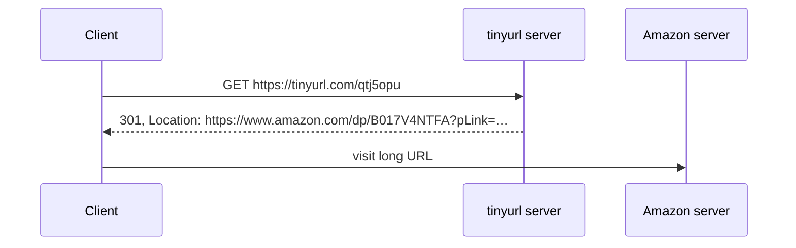
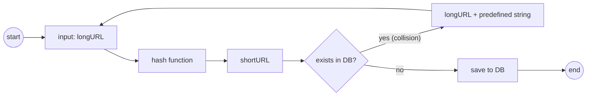
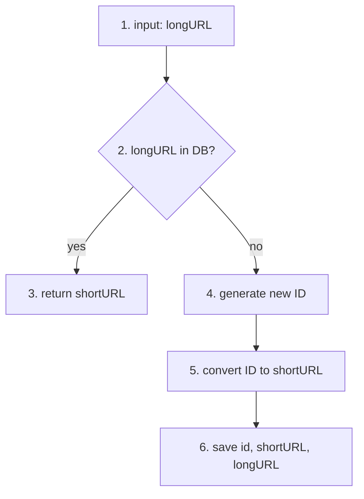
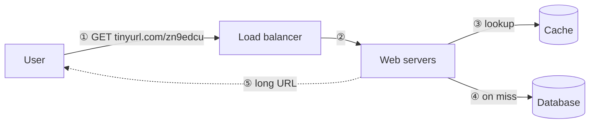

# Chapter 8: Design a URL Shortener

## Core Idea
Two APIs (shorten, redirect) over a `<shortURL, longURL>` table. Size the short code from the estimate (62⁷ ≈ 3.5 T ≥ 365 B URLs → 7 chars), generate it via **base-62 conversion of a distributed unique ID** (no collisions), and serve redirects from cache in front of the DB. Choose 301 vs 302 by load-vs-analytics.

## Frameworks Introduced
- **API (REST)**:
  - `POST api/v1/data/shorten` — body `{longUrl: longURLString}` → returns shortURL.
  - `GET api/v1/shortUrl` → returns longURL for HTTP redirection.
- **301 vs 302**:
  - 301 *Moved Permanently* — browser caches; later clicks bypass the shortener → **lower server load**.
  - 302 *Found (temporary)* — every click hits the shortener → **click analytics** (rate, source).
- **Hash value length**: smallest n with 62ⁿ ≥ total URLs.
- **Two hash strategies**: hash + collision resolution · base-62 conversion.
- **Shortening flow (base 62)**: longURL in DB? → return existing shortURL : generate unique ID → base-62 encode → save (id, shortURL, longURL).

## Key Concepts
- **Character set**: [0-9, a-z, A-Z] = 62 characters. Mapping: 0–9 → '0'–'9', 10–35 → 'a'–'z', 36–61 → 'A'–'Z'.
- **Hash + collision resolution**: take first 7 chars of CRC32/MD5/SHA-1; on collision append a predefined string and rehash; use a **Bloom filter** to avoid a DB lookup per check.
- **Base-62 conversion**: repeatedly divide the ID by 62; remainders (low → high) are the digits.
- **Data model**: `url(id PK auto increment, shortURL, longURL)` in a relational DB (a pure in-memory hash table is too expensive).

## Mental Models
- Use **base 62 + unique ID** when collisions must be impossible and you already have an ID service (Ch 7).
- Use **hash + collision** when you need a fixed length and no ID generator, and can afford collision checks.
- Reads ≫ writes (10:1) → **cache** the mapping.
- Sequential IDs make the next short URL **guessable** — a security concern.

## Anti-patterns
- **Full hash output as the code**: CRC32 is already 8 hex chars; MD5/SHA-1 are far longer.
- **Truncating a hash without collision handling**.
- **DB lookup for every collision check** without a Bloom filter.
- **Using 301 when analytics matter** (you lose visibility after the first click).

## Code Examples
```python
ALPHABET = "0123456789abcdefghijklmnopqrstuvwxyzABCDEFGHIJKLMNOPQRSTUVWXYZ"

def base62(n: int) -> str:
    digits = []
    while n:
        n, r = divmod(n, 62)
        digits.append(ALPHABET[r])
    return "".join(reversed(digits)) or "0"

assert base62(11157) == "2TX"
```
- **What it demonstrates**: the Fig 8-6 conversion (remainders 59→X, 55→T, 2→2).

## Reference Tables

**Back-of-envelope**

| Quantity | Value |
|---|---|
| Writes | 100 M/day → 100 M / 86,400 ≈ **1,160/s** |
| Reads (10:1) | **11,600/s** |
| Records over 10 years | 100 M × 365 × 10 = **365 B** |
| Avg URL length | 100 bytes |
| Storage over 10 years | 365 B × 100 B = **36.5 TB** (book prints 365 TB) |

**Table 8-1 — 62ⁿ capacity**

| n | Max URLs |
|---|---|
| 1 | 62 |
| 2 | 3,844 |
| 3 | 238,328 |
| 4 | 14,776,336 |
| 5 | 916,132,832 |
| 6 | 56,800,235,584 |
| **7** | **3,521,614,606,208 ≈ 3.5 T** |

**Table 8-2 — Hash outputs for `https://en.wikipedia.org/wiki/Systems_design`**

| Function | Hex value |
|---|---|
| CRC32 | 5cb54054 |
| MD5 | 5a62509a84df9ee03fe1230b9df8b84e |
| SHA-1 | 0eeae7916c06853901d9ccbefbfcaf4de57ed85b |

**Table 8-3 — Hash + collision vs base 62**

| Hash + collision resolution | Base 62 conversion |
|---|---|
| Fixed short URL length | Length grows with the ID |
| No unique ID generator needed | Depends on a unique ID generator |
| Collisions possible; must resolve | Collisions impossible (ID unique) |
| Next short URL not guessable | Next short URL guessable if ID +1 — security concern |

## Diagrams

**Fig 8-1/8-2 — 301 redirect**


**Fig 8-3**: longURL → hash function fx → `https://tinyurl.com/qtj5opu`.

**Fig 8-4 — url table**: `id (PK, auto increment) | shortURL | longURL`.

**Fig 8-5 — Hash + collision resolution**


**Fig 8-6 — Base 62 of 11157**

| Divide | Quotient | Remainder | Base 62 |
|---|---|---|---|
| 11157 / 62 | 179 | 59 | X |
| 179 / 62 | 2 | 55 | T |
| 2 / 62 | 0 | 2 | 2 |

Read bottom-up → `2TX` (= 2×62² + 55×62 + 59).

**Fig 8-7 — Shortening flow**


**Fig 8-8 — Redirect flow**


## Worked Example
**Shorten** `https://en.wikipedia.org/wiki/Systems_design`:
1. Not in DB → unique ID generator returns `2009215674938`.
2. Base-62 encode → `zn9edcu`.
3. Insert row (Table 8-4): `2009215674938 | zn9edcu | https://en.wikipedia.org/wiki/Systems_design`.

**Redirect** `https://tinyurl.com/zn9edcu`: LB → web server → cache hit returns longURL; on miss read DB (not in DB → invalid short URL) → return longURL.

## Key Takeaways
1. Estimate first; it fixes code length (7) and storage.
2. Base 62 over a distributed unique ID: simple, collision-free, but guessable.
3. Cache `<shortURL, longURL>`; reads dominate.
4. 301 for load, 302 for analytics.
5. Wrap-up: rate limiter vs abuse, stateless web tier scaling, DB replication/sharding, analytics, availability/consistency/reliability.

## Connects To
- **Ch 7**: unique ID generator feeds base-62 encoding.
- **Ch 4**: rate-limit shortening requests by IP.
- **Ch 1**: stateless web tier, cache, replication/sharding.
- **Ch 6**: Bloom filters reappear in read path.
