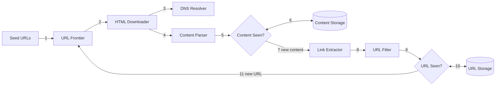
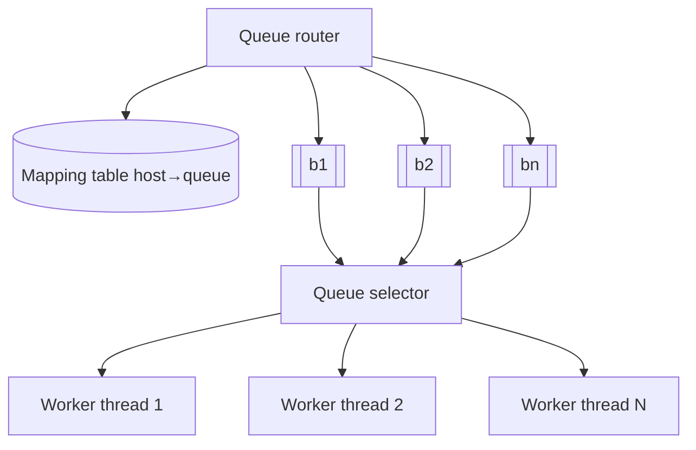
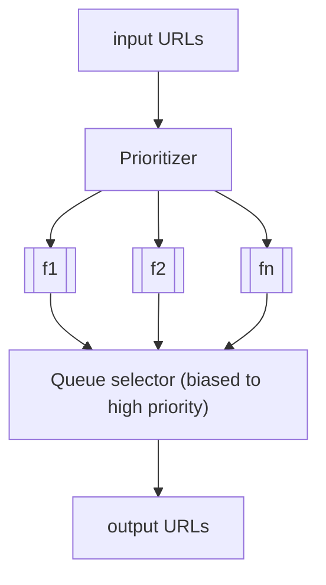

# Chapter 9: Design a Web Crawler

## Core Idea
A crawler is a BFS over the web graph, but plain BFS is impolite and priority-blind. The heart of the design is the **URL frontier** — front queues for priority, back queues (one per host) for politeness — plus dedup at two points ("Content Seen?" by hash, "URL Seen?" by Bloom filter/hash table), and robustness/extensibility so the crawler survives a hostile web.

## Frameworks Introduced
- **Basic algorithm**: (1) download pages for a set of URLs → (2) extract URLs → (3) add new URLs to the to-download list; repeat.
- **Four characteristics of a good crawler**: Scalability · Robustness · Politeness · Extensibility.
- **11-step workflow** (Fig 9-4): seed URLs → frontier → downloader (+DNS) → parser → Content Seen? → link extractor → URL filter → URL Seen? → frontier.
- **URL frontier = front queues (prioritization) + back queues (politeness)**; also handles freshness.
- **HTML downloader optimizations**: distributed crawl · cache DNS resolver · locality · short timeout.
- **Robustness**: consistent hashing across downloaders · save crawl state and data · exception handling · data validation.
- **Problematic content**: redundant content (hash/checksum) · spider traps (max URL length, manual exclusion) · data noise (ads, code snippets, spam URLs).

## Key Concepts
- **Seed URLs**: starting points; partition URL space by locality (country) or topic (shopping, sports, healthcare). Open-ended — think out loud.
- **URL frontier**: stores URLs to be downloaded (FIFO in the simple version).
- **Content Seen?**: ~29% of pages are duplicates; compare page hashes, not characters.
- **URL Seen?**: tracks URLs visited or already queued; prevents reload and infinite loops; Bloom filter or hash table.
- **URL filter**: drops excluded content types, file extensions, error links, blacklisted sites.
- **Robots.txt (Robots Exclusion Protocol)**: check before crawling a site; cache it and refresh periodically.
- **Spider trap**: page structure that loops a crawler forever, e.g. `/foo/bar/foo/bar/…`.
- **Server-side (dynamic) rendering**: render JS/AJAX before parsing to find generated links.

## Mental Models
- Think of the web as a **directed graph**: pages = nodes, links = edges. DFS goes too deep → use BFS.
- Politeness = **one host ↔ one queue ↔ one worker**, with delay between downloads.
- Priority = **biased random choice** across priority queues (PageRank, traffic, update frequency).
- Freshness = recrawl by **update history**; important pages first and more often.
- Frontier storage = **mostly disk + in-memory buffers** for enqueue/dequeue, flushed periodically.

## Anti-patterns
- **Plain FIFO BFS**: floods one host (most links are internal) and ignores page importance.
- **Parser inside the crawl server**: slows crawling — make it a separate component.
- **Character-by-character duplicate detection**: too slow at billions of pages.
- **Frontier entirely in memory** (not durable/scalable) or entirely on disk (bottleneck).
- **Synchronous DNS per request**: 10–200 ms each, blocks other threads → cache it, refresh by cron.
- **Waiting forever on slow hosts**: set a short timeout and move on.

## Reference Tables

**Back-of-envelope**

| Quantity | Value |
|---|---|
| Pages/month | 1 B |
| QPS | 1 B / 30 / 24 / 3600 ≈ **400 pages/s** |
| Peak QPS | **800** |
| Avg page size | 500 KB |
| Storage/month | 1 B × 500 KB = **500 TB** |
| 5-year storage | 500 TB × 12 × 5 = **30 PB** |

**Step 1 scope**: purpose = search engine indexing · 1 B pages/month · HTML only · include new/edited pages · store HTML up to 5 years · ignore duplicate content.

**Table 9-1 — Host → back queue mapping**: wikipedia.com → b1 · apple.com → b2 · … · nike.com → bn.

**Robots.txt excerpt (amazon.com)**
```text
User-agent: Googlebot
Disallow: /creatorhub/*
Disallow: /rss/people/*/reviews
Disallow: /gp/pdp/rss/*/reviews
Disallow: /gp/cdp/member-reviews/
Disallow: /gp/aw/cr/
```

## Diagrams

**Fig 9-1 — Crawl expansion**: seed page links a.com, b.com, c.com → a.com links lime/peach/mango, b.com links banana, c.com links orange/plum.

**Fig 9-2 / 9-4 — High-level design and workflow**


**Fig 9-3 — Link extraction**: `<a href="/wiki/Cong_Weixi">`, `/wiki/Kay_Hagan`, `/wiki/Vladimir_Bukovsky`, `/wiki/John_Conyers` → prefixed with `https://en.wikipedia.org` to absolute URLs.

**Fig 9-5 — Why BFS is impolite**: wikipedia.com → page1…pageN → page1/1, page1/2, … all on the same host.

**Fig 9-6 — Politeness (back queues)**


**Fig 9-7 — Priority (front queues)**


**Fig 9-8 — Full URL frontier**: Prioritizer → f1…fn → Front queue selector → Back queue router (+ mapping table) → b1…bn → Back queue selector → worker threads.

**Fig 9-9 — Distributed crawl**: URL frontier distributes URL partitions to many HTML downloader servers.

**Fig 9-10 — Extensibility**: after Content Seen?, an extension module fans out to **PNG Downloader**, **Link Extractor**, and **Web Monitor** (copyright/trademark).

## Worked Example
**One URL through the pipeline**: seed `wikipedia.org` enters the frontier → prioritizer puts it in a high-priority front queue → back queue router maps host `wikipedia.com` → b1 → worker 1 (sole consumer of b1) checks cached robots.txt, resolves IP via DNS cache, downloads with a short timeout → parser validates HTML → hash not in content storage → link extractor yields 4 absolute `/wiki/…` URLs → filter drops none → URL Seen? (Bloom filter) says 3 are new → those 3 go back to the frontier, again routed by host to b1, so Wikipedia is still hit by one thread at a time with delays.

## Key Takeaways
1. Clarify purpose, volume, content types, freshness, retention, and dedup policy first.
2. BFS with a smart frontier: front queues for priority, back queues per host for politeness.
3. Dedup twice: content by hash, URLs by Bloom filter/hash table.
4. Speed: distribute, cache DNS, go geo-local, use short timeouts.
5. Survive the web: consistent hashing, checkpoint state, handle exceptions, validate data, cap URL length.
6. Wrap-up extras: server-side rendering, anti-spam filtering, DB replication/sharding, stateless horizontal scaling, analytics.

## Connects To
- **Ch 5**: consistent hashing distributes URLs across downloaders.
- **Ch 6**: Bloom filters for membership tests.
- **Ch 4**: politeness is self-imposed rate limiting.
- **Ch 13**: search autocomplete consumes crawled/indexed data.
