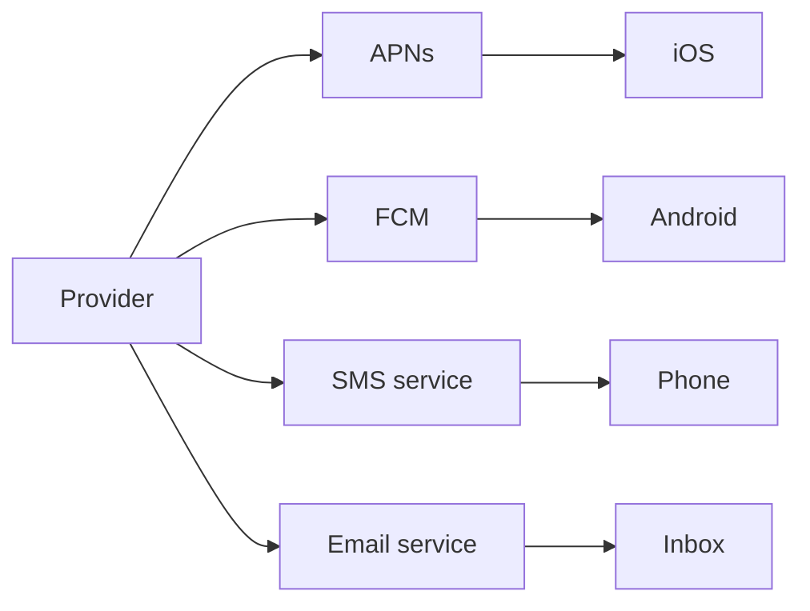
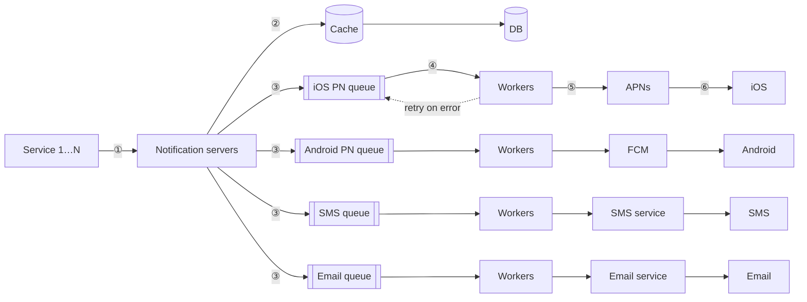
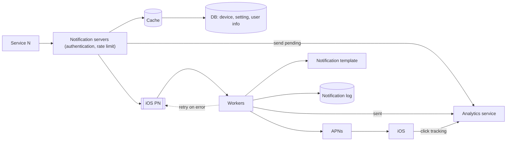

# Chapter 10: Design a Notification System

## Core Idea
Services call notification servers, which validate, enrich from cache/DB, and enqueue to **one message queue per channel** (iOS PN, Android PN, SMS, email); workers pull and call third-party providers (APNs, FCM, Twilio, SendGrid). Never lose a notification: persist to a notification log, retry on error, dedupe by event ID — delivery is at-least-once, not exactly-once.

## Frameworks Introduced
- **Three formats**: mobile push · SMS · email.
- **Provider → third-party → device** pattern per channel:
  - iOS: Provider (device token + JSON payload) → **APNs** → iOS device.
  - Android: Provider → **FCM** → Android device (FCM unavailable in China → Jpush, PushY).
  - SMS: Provider → Twilio / Nexmo → phone.
  - Email: Provider → SendGrid / Mailchimp → inbox.
- **Three flows**: notification types · contact-info gathering · sending/receiving.
- **Initial design's three problems**: SPOF · hard to scale · performance bottleneck → fix by moving DB/cache out, autoscaling notification servers, and adding message queues.
- **6-step send flow**: service calls API → servers fetch metadata (cache/DB) → event to channel queue → workers pull → workers call third party → third party delivers to device.
- **Deep-dive add-ons**: notification template · notification setting (opt-in) · rate limiting · retry mechanism · security (appKey/appSecret) · monitor queued notifications · events tracking.

## Key Concepts
- **Device token**: unique identifier for push delivery; a user can have many devices.
- **Soft real-time**: deliver ASAP; slight delay acceptable under load.
- **Notification log DB**: persisted notifications so failures can be retried — "delayed or re-ordered, never lost".
- **Dedupe**: on arrival, check event ID; seen → discard, else send.
- **Notification template**: preformatted body/CTA with parameters — consistent format, fewer errors, saves time.
- **Notification setting table**: `user_id bigint, channel varchar (push/email/SMS), opt_in boolean` — check before every send.
- **Queued-notifications metric**: high count → workers too slow → add workers.

## Mental Models
- Think of **one queue per channel** as a bulkhead: a third-party outage stalls only its own channel.
- Treat third parties as **pluggable**: add/remove providers per market without redesign.
- Rate-limit **per user** — over-notifying makes users disable notifications entirely.
- Track a notification as a **state machine** for analytics.

## Anti-patterns
- **Single notification server** doing everything (SPOF, can't scale components independently, overloads at peak).
- **Public send APIs** — restrict to internal or verified clients to prevent spam.
- **Assuming exactly-once** delivery in a distributed system.
- **Sending without checking opt-in**.

## Code Examples
```json
// iOS push payload (APNs)
{ "aps": { "alert": { "title": "Game Request",
                      "body": "Bob wants to play chess",
                      "action-loc-key": "PLAY" },
           "badge": 5 } }
```

```json
// POST https://api.example.com/v/sms/send  (book's send-email example)
{ "to": [ { "user_id": 123456 } ],
  "from": { "email": "from_address@example.com" },
  "subject": "Hello, World!",
  "content": [ { "type": "text/plain", "value": "Hello, World!" } ] }
```

```text
Template — BODY: You dreamed of it. We dared it. [ITEM NAME] is back — only until [DATE].
           CTA:  Order Now. Or, Save My [ITEM NAME]
```

## Reference Tables

**Step 1 scope**: push, SMS, email · soft real-time · iOS, Android, laptop/desktop · triggered by clients or scheduled server-side · users can opt out · daily volume: **10 M push, 1 M SMS, 5 M email**.

**Fig 10-8 — Contact info schema**

| user | | device | |
|---|---|---|---|
| user_id | bigint (PK) | id | bigint (PK) |
| email | varchar | device_token | varchar |
| country_code | integer | user_id | bigint (FK, many devices : 1 user) |
| phone_number | integer | last_logged_in_at | timestamp |
| created_at | timestamp | | |

| Component | Responsibility |
|---|---|
| Notification servers | Internal/verified APIs · validate emails/phones · fetch render data from cache/DB · enqueue |
| Cache | user info, device info, templates |
| DB | users, notifications, settings |
| Message queues | decouple; buffer spikes; one per type |
| Workers | pull events, call third party; retry on error |

## Diagrams

**Fig 10-1**: examples — lock-screen push (stock alert, Amazon delivery), SMS (AT&T outage), marketing email.

**Fig 10-2 to 10-6 — Channels**


**Fig 10-7 — Contact info gathering**: User (on app install or sign up) → load balancer → API servers → store contact info in DB.

**Fig 10-9 — Initial design**: Service 1…N → single Notification System → APNs/FCM/SMS/Email third parties → devices.

**Fig 10-10 — Improved design**


**Fig 10-11 — Prevent data loss**: iOS PN queue → workers → APNs, with workers writing every notification to a **notification log** DB.

**Fig 10-12 — Monitoring**: line chart of queued messages over the last minute (spikes to ~200) — the signal to add workers.

**Fig 10-13 — Event tracking states**
```mermaid
stateDiagram-v2
  [*] --> pending
  pending --> sent
  pending --> error
  sent --> error
  sent --> deliver
  deliver --> click
  deliver --> unsubscribe
```

**Fig 10-14 — Updated design**


## Worked Example
**A billing reminder email, end to end**: billing service calls `POST /send` with user_id → notification server authenticates the caller, checks rate limit, validates the address, loads user + opt-in setting (email opted in) from cache → renders from a template → logs "pending" to analytics → enqueues to the email queue → a worker checks the event ID (unseen), writes to the notification log, calls SendGrid → SendGrid times out → event goes back on the queue; retries up to a limit, then alerts developers → second attempt succeeds → "sent" event to analytics → user clicks → click tracked.

## Key Takeaways
1. Decouple with a queue per channel; scale workers by queue depth.
2. Persist + retry so nothing is lost; dedupe by event ID because exactly-once is impossible.
3. Respect user settings (opt-in) and cap frequency per user.
4. Secure send APIs (appKey/appSecret; verified clients only).
5. Templates, monitoring, and event tracking turn a sender into a product.

## Connects To
- **Ch 1**: message queues and horizontal scaling.
- **Ch 4**: per-user rate limiting.
- **Ch 11**: news feed fans out notifications via this system.
- **Ch 12**: offline chat users receive push notifications.
