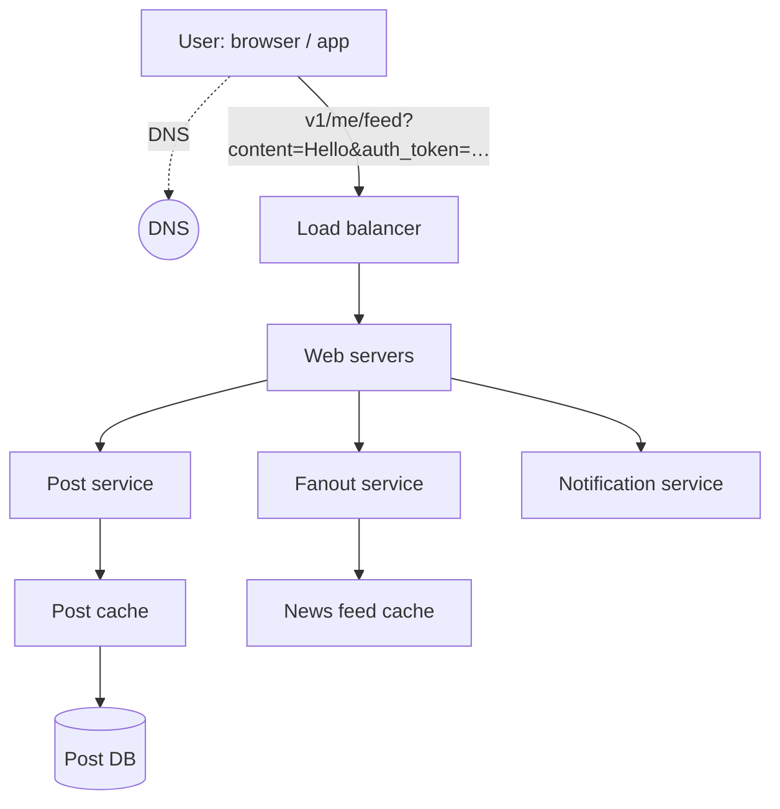
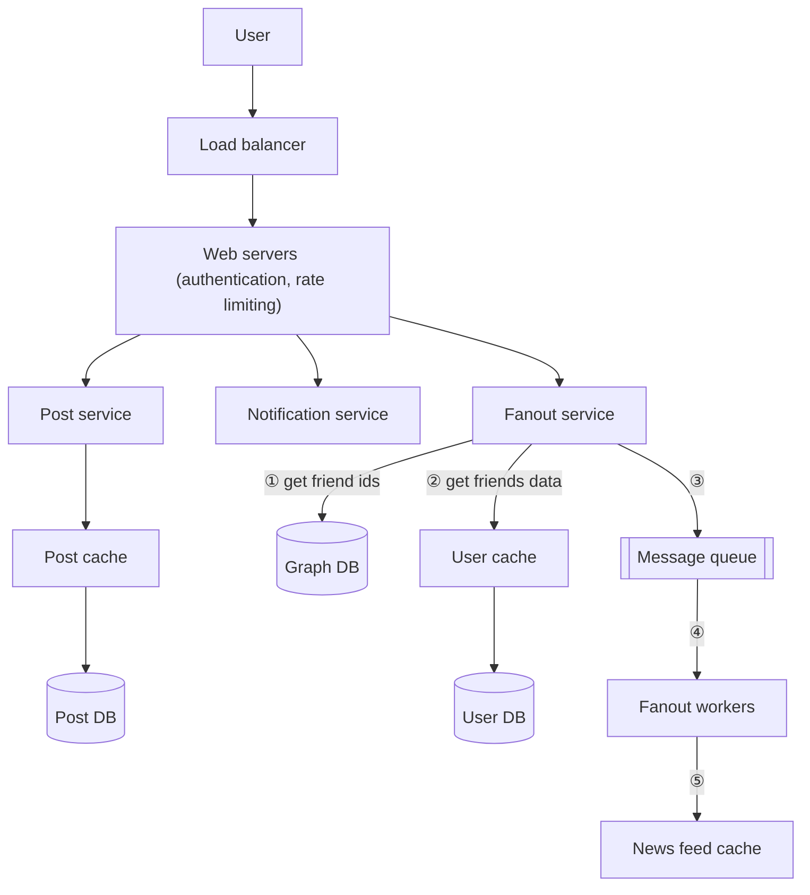
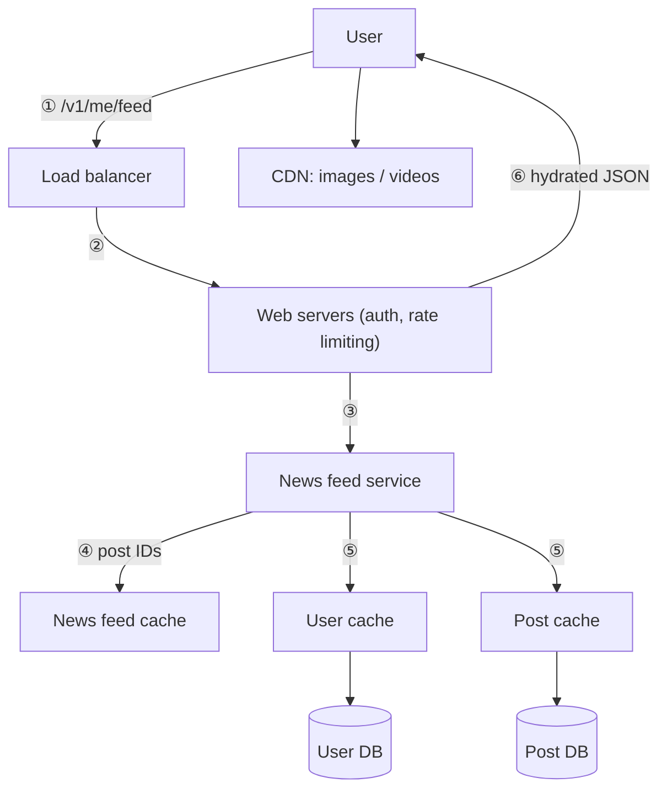

# Chapter 11: Design a News Feed System

## Core Idea
Split into **feed publishing** (post service + fanout service) and **news feed retrieval** (news feed service hydrating IDs from caches). The central trade-off is fanout: **push (on write)** for normal users, **pull (on read)** for celebrities — a hybrid. Cache only `<post_id, user_id>` IDs in the feed cache and hydrate from user/post caches at read time.

## Frameworks Introduced
- **Two flows**: feed publishing · news feed building/retrieval.
- **APIs**:
  - `POST /v1/me/feed` — params `content`, `auth_token`.
  - `GET /v1/me/feed` — param `auth_token`.
- **Fanout models**:
  - *Fanout on write (push)*: pre-compute feeds at write time.
  - *Fanout on read (pull)*: build feed on demand when the user loads home.
  - **Hybrid**: push for most users; celebrities/many-follower users are pulled on demand. Consistent hashing spreads hotkey load.
- **Fanout service, 5 steps**: ① get friend IDs (graph DB) → ② get friends' data from user cache, filter by settings (muted, selective sharing) → ③ send friend list + post ID to message queue → ④ fanout workers consume → ⑤ write `<post_id, user_id>` into news feed cache.
- **Retrieval, 6 steps**: ① GET /v1/me/feed → ② LB → ③ web servers call news feed service → ④ post IDs from news feed cache → ⑤ hydrate from user cache + post cache → ⑥ return JSON; media from CDN.
- **5-layer cache**: News Feed · Content · Social Graph · Action · Counters.

## Key Concepts
- **Hotkey problem**: a user with huge friend/follower lists makes push fanout slow.
- **Graph DB**: suited for friend relationships and recommendations.
- **Fully hydrated feed**: IDs expanded to username, profile pic, content, images.
- **Configurable cache limit**: keep only the latest N IDs per user; few users scroll thousands deep → low miss rate.
- **Web servers** enforce **authentication** (valid auth_token) and **rate limiting** (anti-spam).

## Mental Models
- Use **push** when reads must be fast and fan-out is small; use **pull** for the long tail of celebrities and for inactive users.
- Store **IDs, not objects**, in fan-out caches — memory is the constraint.
- Think of the cache tier as **layers by data type**, each with its own hot/normal split.

## Anti-patterns
- **Pure push**: celebrity posts overload fanout; wasted work for inactive users.
- **Pure pull**: slow feed loads.
- **Storing full user/post objects in the feed cache**: memory explodes.
- **Unlimited feed cache depth**.

## Reference Tables

| | Fanout on write (push) | Fanout on read (pull) |
|---|---|---|
| When feed is built | at write time | at read time |
| Read latency | fast (pre-computed) | slow |
| Real-time push | yes | no |
| Celebrity / many friends | hotkey problem | no hotkey problem |
| Inactive users | wasted compute | no waste |

**Step 1 scope**: mobile + web · publish a post and see friends' posts · reverse chronological · ≤ 5,000 friends · 10 M DAU · images and videos allowed.

**Fig 11-8 — Cache layers**

| Layer | Contents |
|---|---|
| News Feed | news feed IDs |
| Content | hot cache · normal |
| Social Graph | follower · following |
| Action | liked · replied · others |
| Counters | like counter · reply counter · other counters |

## Diagrams

**Fig 11-1**: phone mock-up of a feed — posts with avatar, text, video.

**Fig 11-2 — Feed publishing (high level)**

**Fig 11-3 — Feed building (high level)**: User → `v1/me/feed` → LB → web servers → news feed service → news feed cache.

**Fig 11-4 / 11-5 — Publishing deep dive**

**Fig 11-6 — News feed cache**: a list of `<post_id, user_id>` rows per user, appended on each new post.

**Fig 11-7 — Retrieval deep dive**

## Worked Example
**Alice (300 friends) posts "Hello"; Bob (a celebrity, 50 M followers) posts too.**
- Alice: web server authenticates, rate-limits → post service writes post cache + DB → fanout service reads 300 friend IDs from graph DB, drops 2 who muted her via user cache → enqueues (298 IDs, post_id) → workers prepend post_id to 298 feed caches. Friends' next GET returns it instantly.
- Bob: hybrid rule says *don't push* — his post is only written to post storage. When a follower opens the feed, the news feed service merges the follower's pre-computed feed IDs with recent posts pulled from the celebrities they follow, then hydrates everything from user/post caches; images stream from CDN.

## Key Takeaways
1. Two flows: publish and retrieve; design each separately.
2. Hybrid fanout — push for normal users, pull for celebrities; consistent hashing for hotkeys.
3. Feed cache holds IDs only, with a depth limit; hydrate on read.
4. Graph DB for relationships; respect mute/visibility settings during fanout.
5. Five cache layers: feed, content, social graph, action, counters.
6. Wrap-up: DB scaling (vertical/horizontal, SQL/NoSQL, replication, read replicas, consistency, sharding), stateless web, caching, multi-DC, queues, monitor peak QPS and refresh latency.

## Connects To
- **Ch 3**: news feed is the worked example for the 4-step framework.
- **Ch 10**: notification service informs friends of new posts.
- **Ch 5**: consistent hashing to mitigate hotkeys.
- **Ch 1**: celebrity problem in sharding.
