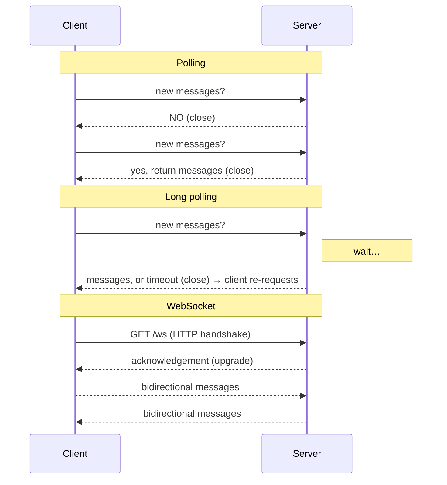
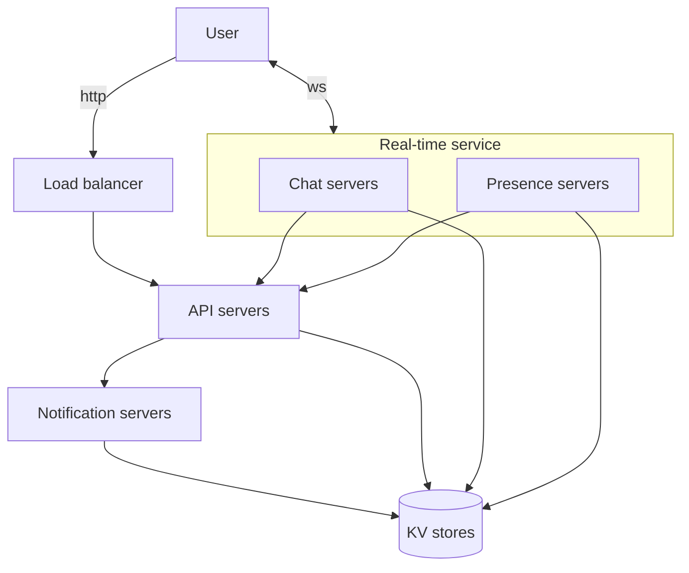
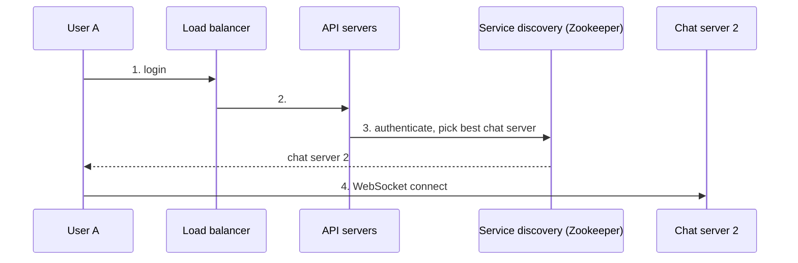
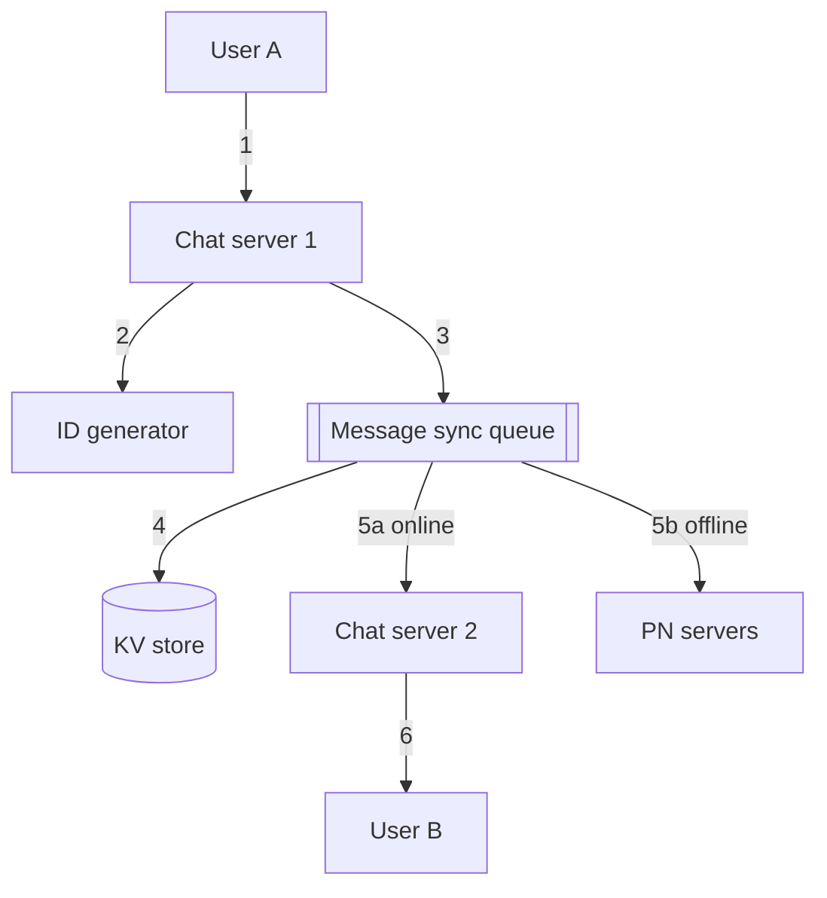
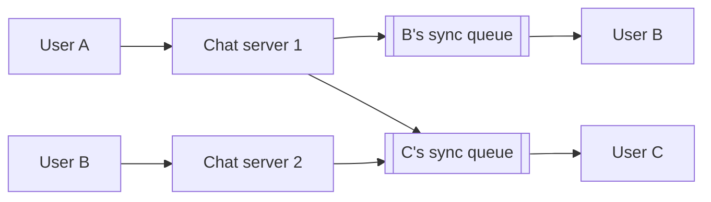
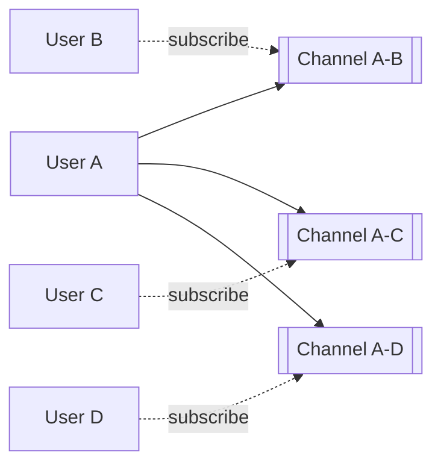

# Chapter 12: Design a Chat System

## Core Idea
Clients hold a persistent **WebSocket** to a stateful chat server (assigned by service discovery); everything else (login, profile) is stateless HTTP. Messages get a time-sortable ID, pass through a per-recipient **message sync queue**, persist in a **key-value store**, and go to the recipient's chat server if online or to push notification if offline. Presence uses heartbeats and pub/sub fanout.

## Frameworks Introduced
- **Chat service duties**: receive messages · find recipients and relay · hold messages for offline recipients.
- **Receiver-side techniques**: polling → long polling → **WebSocket** (chosen; use it for sending too).
- **Three component categories**: stateless services (behind LB: service discovery, auth, group management, user profile) · stateful service (chat service) · third-party integration (push notification).
- **Servers in the adjusted design**: chat servers · presence servers · API servers · notification servers · KV store.
- **Message ID requirements**: unique + sortable by time. Options: MySQL auto_increment (NoSQL lacks it) · global 64-bit snowflake (Ch 7) · **local sequence generator** (unique within a channel — sufficient and simpler).
- **1-on-1 flow (6 steps)**: A → chat server 1 → ID generator → message sync queue → KV store → (online) chat server 2 → B / (offline) PN servers.
- **Multi-device sync**: each device keeps `cur_max_message_id`; new = recipient is me AND id > cur_max.
- **Small group**: copy message into **each member's** sync queue (inbox); fine up to ~100 (WeChat caps 500).
- **Presence**: login → status online + `last_active_at` in KV; logout → offline; disconnection → **heartbeat** with timeout x; fanout via **pub/sub channel per friend pair**.

## Key Concepts
- **Polling**: client asks periodically; mostly "no" → wasteful.
- **Long polling**: server holds request until data or timeout; issues: sender/receiver may be on different stateless servers, can't detect disconnect, still reconnects for idle users.
- **WebSocket**: client-initiated HTTP upgrade → bidirectional, persistent; ports 80/443 pass firewalls.
- **Service discovery (Apache Zookeeper)**: registers chat servers, picks best by location/capacity.
- **Message sync queue**: a recipient's inbox; can receive from many senders.
- **Heartbeat**: client pings every few seconds; no heartbeat for x seconds → offline.

## Mental Models
- Use **HTTP for request/response features**, WebSocket only for real-time.
- Stateful connections → **sticky by design**: a client stays on its chat server until it fails; service discovery re-assigns on failure.
- Choose **KV store for chat history**: huge volume (60 B msgs/day at FB+WhatsApp), recent-heavy, ~1:1 read/write, need random access (search, mentions, jump) — relational DBs handle the long tail poorly. FB Messenger: HBase; Discord: Cassandra.
- Use **message_id, not created_at**, for ordering — two messages can share a timestamp.
- Presence fanout is **O(friends)** per change — for 100k-member groups, fetch status lazily (on entering group / manual refresh).

## Anti-patterns
- **Designing group chat when 1-on-1 was meant** (or vice versa) — nail scope first.
- **Single-server design as the final answer**: 1 M connections × 10 KB ≈ 10 GB fits on one box, but SPOF is a deal breaker. Fine as a *starting point* if you say so.
- **Marking offline on every disconnect**: flickers in tunnels → use heartbeat timeout.
- **Copy-per-member inbox for huge groups**.

## Reference Tables

**Step 1 scope**: 1-on-1 + group · mobile + web · 50 M DAU · group ≤ 100 members · features: 1-on-1, group, online indicator, text only · message < 100,000 chars · E2E encryption not required now · history kept forever · multi-device · push notifications.

| Technique | Server push? | Cost | Problems |
|---|---|---|---|
| Polling | simulated | high (empty answers) | latency vs cost trade-off |
| Long polling | simulated | medium | stateless routing mismatch; no disconnect detection; idle reconnects |
| WebSocket | native, bidirectional | low per message | persistent connection management on server |

**Data models**

| message (1-on-1) | type |
|---|---|
| **message_id** (PK) | bigint |
| message_from | bigint |
| message_to | bigint |
| content | text |
| created_at | timestamp |

| group_message | type |
|---|---|
| **channel_id** (partition key, PK part) | bigint |
| **message_id** (PK part) | bigint |
| user_id | bigint |
| content | text |
| created_at | timestamp |

## Diagrams

**Fig 12-1**: WhatsApp, Facebook Messenger, WeChat, Line, Google Hangout, Discord.

**Fig 12-2**: sender → chat service (1. store message, 2. relay message) → receiver.

**Fig 12-3/12-4/12-5 — Polling vs long polling vs WebSocket**

**Fig 12-7 — Categories**: Stateless (User —http→ LB → service discovery, authentication service, group management, user profile) · Stateful (users ↔ ws ↔ chat service) · Third party (push notification).

**Fig 12-8 — Adjusted high-level design**

**Fig 12-11 — Service discovery**

**Fig 12-12 — 1-on-1 message flow**

**Fig 12-13 — Multi-device sync**: User A's phone (`cur_max_message_id = 653`) and laptop (`= 842`) each hold a session on chat server 1; each pulls from the KV store messages for user A with id > its own cur_max.

**Fig 12-14/12-15 — Group chat inboxes**

**Fig 12-16 — Login presence**: User A ↔ ws ↔ presence servers → KV `User A: {status: online, last_active_at: timestamp}`.
**Fig 12-17 — Logout**: User A → logout → API servers → presence servers → KV `{status: offline}`.

**Fig 12-18 — Heartbeat**: heartbeats at 0 s, 5 s, 10 s → "online"; then silence; no heartbeat for x = 30 s → "offline".

**Fig 12-19 — Presence fanout**

## Worked Example
**A sends "hi" to B, who is on a laptop and a phone.**
1. A's WebSocket delivers "hi" to chat server 1 → ID generator issues local sequence id 843 for channel A-B.
2. Message goes to B's sync queue and is persisted in the KV store (`message_id=843, from=A, to=B`).
3. B is online (presence: heartbeat within 30 s) → forwarded to chat server 2 → pushed over B's WebSocket.
4. B's phone was at `cur_max_message_id = 842` → fetches 843; the laptop was at 653 → fetches 654…843.
5. Had B been offline, PN servers would push a notification; B fetches history on reconnect.

## Key Takeaways
1. Clarify 1-on-1 vs group, scale, group size, features, retention — chat apps differ wildly.
2. WebSocket for real-time both directions; HTTP for everything else.
3. Service discovery (Zookeeper) assigns chat servers; reassign on server failure.
4. KV store for chat history; message_id (local or snowflake) for ordering.
5. Per-recipient inbox for small groups; per-device `cur_max_message_id` for sync.
6. Presence = heartbeat timeout + pub/sub per friend pair; go lazy for big groups.
7. Wrap-up: media (compression, cloud storage, thumbnails), E2E encryption, client-side caching, geo-distributed caching (Slack), chat server failure, message resend (retry + queue).

## Connects To
- **Ch 7**: snowflake / message ID generation.
- **Ch 6**: KV store for chat history.
- **Ch 10**: push notifications for offline users.
- **Ch 1**: stateless vs stateful tiers.
