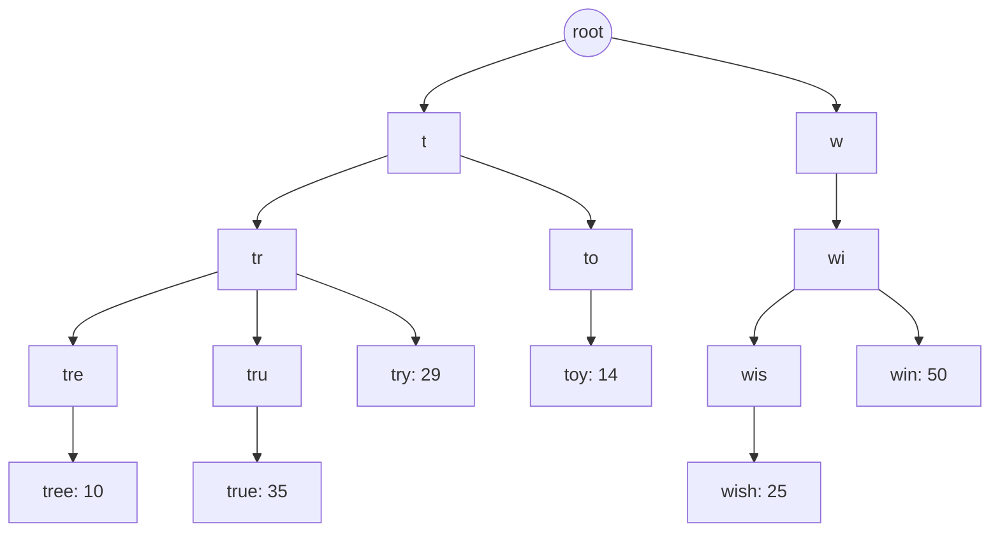
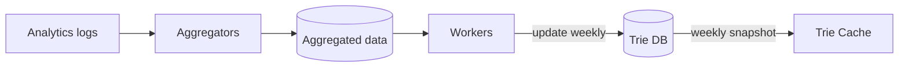
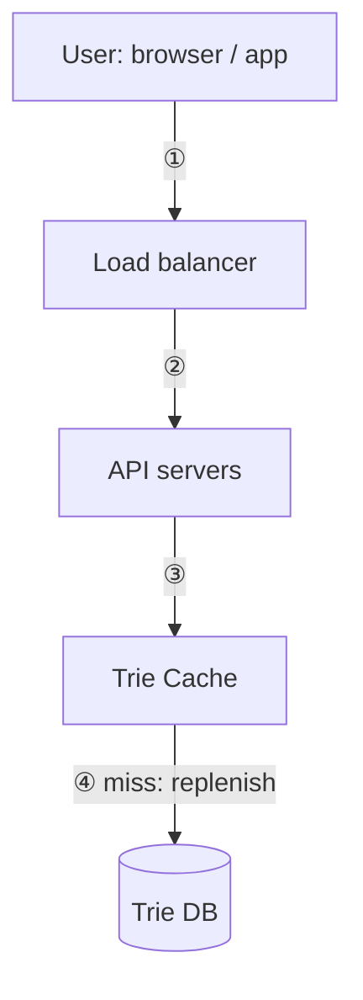

# Chapter 13: Design a Search Autocomplete System

## Core Idea
"Design top k most searched queries." Serve prefix lookups in O(1) from a **trie that caches the top k queries at every node**, held in a distributed Trie Cache backed by a Trie DB. Build the trie **offline** (logs → aggregators → workers, e.g. weekly) rather than updating it on every query. Shard by historical prefix distribution, filter unsafe suggestions in a layer in front of the cache.

## Frameworks Introduced
- **Two services**: data gathering service (aggregate queries) · query service (return top 5 for a prefix).
- **Top-k on a basic trie**: ① find prefix node O(p) → ② traverse subtree for valid children O(c) → ③ sort, take k O(c log c).
- **Two optimizations → O(1)**:
  1. **Limit max prefix length** (e.g. 50) → find prefix in O(1).
  2. **Cache top k at each node** → return in O(1). Trades space for time.
- **Data gathering pipeline**: Analytics logs → Aggregators → Aggregated data → Workers → Trie DB → Trie Cache (weekly snapshot).
- **Trie DB options**: document store (serialize weekly snapshot, e.g. MongoDB) · key-value store (prefix → node data).
- **Query service optimizations**: AJAX requests · browser caching (`cache-control: private, max-age=3600`) · data sampling (log 1 in N).
- **Trie operations**: create (workers from aggregated data) · update (replace weekly, or update node + all ancestors — slow) · delete (filter layer, then physical removal async).
- **Scale storage**: first-level sharding by first letter (up to 26), then second level (`aa-ag`, `ah-an`, `ao-au`, `av-az`); fix skew with a **shard map manager** driven by historical distribution.

## Key Concepts
- **Trie (prefix tree)**: root = empty string; each node = a character/prefix with up to 26 children; terminal nodes mark full queries.
- **p / n / c**: prefix length / total nodes / children of a node.
- **Filter layer**: removes hateful, violent, sexually explicit, or dangerous suggestions before they reach API servers.
- **Shard map manager**: lookup DB that says which shard holds a prefix range (e.g. 's' alone vs 'u'–'z' together).

## Mental Models
- Reads dominate and must be < 100 ms → **precompute everything**, serve from memory.
- Top suggestions are **stable** → batch rebuild beats real-time updates (verify with interviewer; Twitter-like products need shorter intervals).
- Letters aren't uniform (many more 'c' than 'x') → **shard by data, not alphabet**.

## Anti-patterns
- **SQL `LIKE 'prefix%' ORDER BY frequency LIMIT 5`** at scale — DB becomes the bottleneck.
- **Updating the trie on every query** — billions/day slow the query service.
- **Traversing the whole subtree per request**.
- **Naive alphabetical sharding** — uneven distribution.

## Code Examples
```sql
-- High-level design's naive query (Fig 13-4)
SELECT * FROM frequency_table
WHERE query LIKE 'prefix%'
ORDER BY frequency DESC
LIMIT 5;
```

## Reference Tables

**Back-of-envelope**

| Quantity | Value |
|---|---|
| DAU | 10 M |
| Searches/user/day | 10 |
| Bytes/query | 4 words × 5 chars = 20 B (ASCII) |
| Requests/query | ~20 (one per keystroke: `q=d`, `q=di`, … `q=dinner`) |
| QPS | 10 M × 10 × 20 / 86,400 ≈ **24,000** |
| Peak QPS | **~48,000** |
| New data/day | 10 M × 10 × 20 B × 20% new = **0.4 GB** |

**Requirements**: fast (< 100 ms, per Facebook) · relevant · sorted by popularity · scalable · highly available. Scope: prefix match at start only · 5 suggestions · ranked by historical frequency · no spell check · English · lowercase alphabetic · 10 M DAU.

**Table 13-1 — Frequency table**: twitter 35 · twitch 29 · twilight 25 · twin peak 21 · twitch prime 18 · twitter search 14 · twillo 10 · twin peak sf 8 → "tw" shows twitter, twitch, twilight, twin peak, twitch prime.

**Table 13-3 — Raw analytics log**: (query, time) rows, e.g. tree 2019-10-01 22:01:01, try 22:01:05, tree 22:01:30, toy 22:02:22 … append-only, unindexed.

**Table 13-4 — Weekly aggregated**

| query | week start | frequency |
|---|---|---|
| tree | 2019-10-01 | 12000 |
| tree | 2019-10-08 | 15000 |
| tree | 2019-10-15 | 9000 |
| toy | 2019-10-01 | 8500 |
| toy | 2019-10-08 | 6256 |
| toy | 2019-10-15 | 8866 |

## Diagrams

**Fig 13-2 — Frequency table updates**: queries twitch, twitter, twitter, twillo → {twitch:1} → {twitch:1, twitter:1} → {twitch:1, twitter:2} → {twitch:1, twitter:2, twillo:1}.

**Fig 13-5/13-6 — Trie with frequencies** (Table 13-2: tree 10, try 29, true 35, toy 14, wish 25, win 50)


**Fig 13-7 — Top-2 for "be" (unoptimized)**: ① walk root→b→be ② collect subtree {bee:20, beer:10, best:35, bet:29} ③ sort → [best: 35, bet: 29].

**Fig 13-8 — Top-k cached per node**
```text
b    → [best:35, bet:29, bee:20, be:15, buy:14]
be   → [best:35, bet:29, bee:20, be:15, beer:10]
bee  → [bee:20, beer:10]      bes → [best:35]      bu → [buy:14]
w    → [win:11]               wi  → [win:11]
```

**Fig 13-9 — Data gathering**


**Fig 13-10 — Trie as KV**: key = prefix, value = cached top list: `b → [be:15, bee:20, beer:10, best:35]`, `be → same`, `bee → [bee:20, beer:10]`, `bes → [best:35]`, `beer → [beer:10]`, `best → [best:35]`.

**Fig 13-11 — Query service**


**Fig 13-12**: Google autocomplete response header `cache-control: private, max-age=3600` — cache per-user in browser for 1 hour.

**Fig 13-13 — Update "beer" 10 → 30**: beer node and every ancestor (bee, be, b) re-rank their cached lists: `be → [best:35, beer:30, bee:20, be:15]`.

**Fig 13-14 — Filter layer**: Trie Cache → Filter layer → API servers.

**Fig 13-15 — Smarter sharding**: web servers ① ask shard map manager "what shard is it?" ② retrieve from that shard (shard 1, shard 2, …).

## Worked Example
**User types "be"** (k = 5, optimized trie):
1. Browser sends AJAX `search?q=be` (or serves it from browser cache if seen in the last hour).
2. LB → API server → shard map manager says 'b' lives on shard 1 → Trie Cache lookup key `be`.
3. Node `be` already holds `[best:35, bet:29, bee:20, be:15, beer:10]` → pass through filter layer → return. O(1).
4. Meanwhile 1-in-N queries are logged; aggregators roll up weekly; workers rebuild the trie and snapshot it into Trie Cache.

## Key Takeaways
1. Trie + per-node top-k cache + capped prefix length = O(1) lookups.
2. Rebuild offline from aggregated logs; avoid per-query writes.
3. Serve from distributed Trie Cache; persist trie in document or KV store.
4. Speed up clients with AJAX, browser caching, and sampling.
5. Shard by historical distribution via a shard map manager.
6. Follow-ups: Unicode for multi-language · per-country tries on CDNs · trending queries need streaming (Hadoop MapReduce, Spark Streaming, Storm, Kafka), recency-weighted ranking, smaller sharded working sets.

## Connects To
- **Ch 2**: QPS estimation per keystroke.
- **Ch 6**: trie stored as key-value pairs.
- **Ch 1**: sharding and its hotspot/uneven-data pitfalls.
- **Ch 9**: crawler/analytics pipelines feed offline aggregation.
