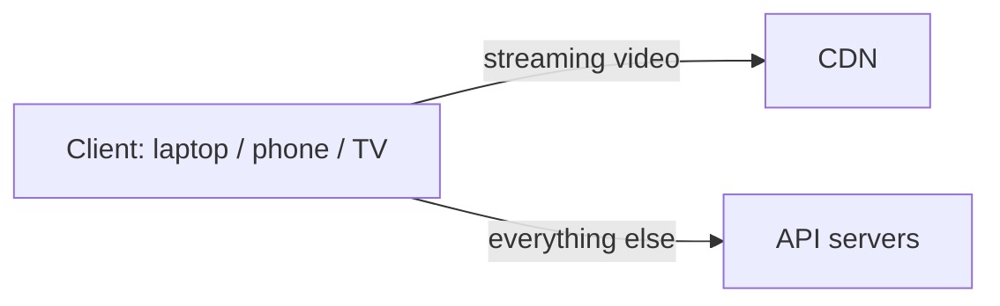
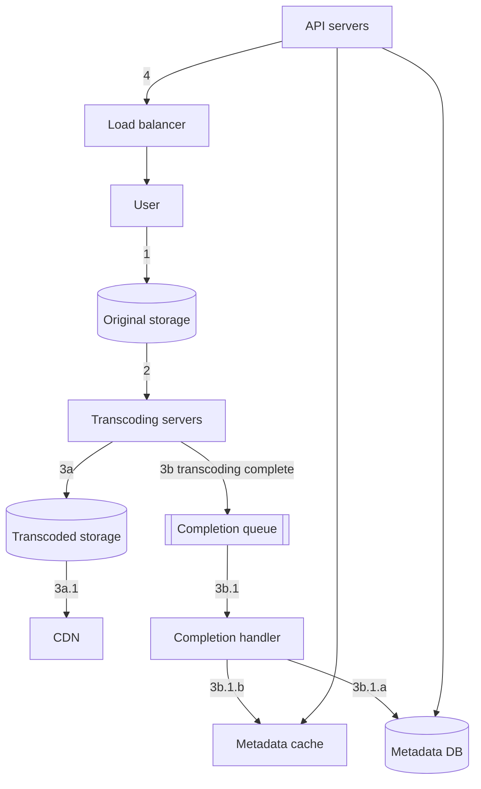
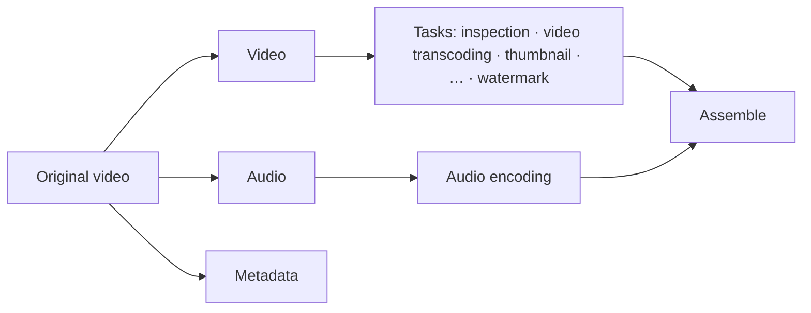
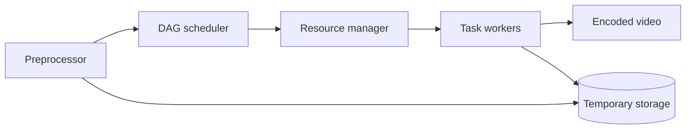
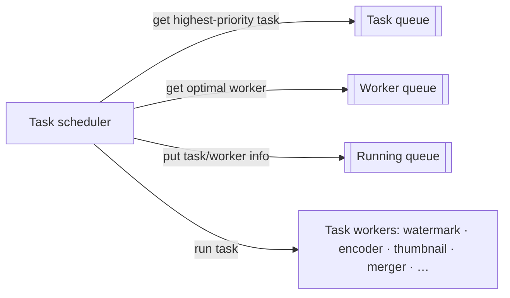
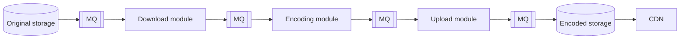
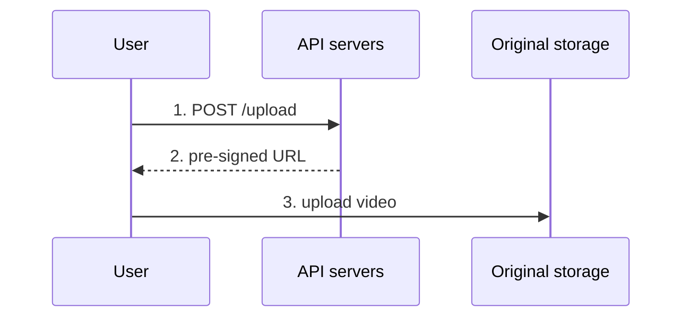

# Chapter 14: Design YouTube

## Core Idea
Lean on cloud **blob storage + CDN**; build the pieces that differentiate. Two flows: **upload** (original storage → transcoding → transcoded storage → CDN, with a completion queue updating metadata) and **streaming** (client pulls adaptive streams from the nearest CDN edge). Transcoding is a configurable **DAG** run by a preprocessor → DAG scheduler → resource manager → task workers pipeline. CDN cost dominates, so serve by popularity.

## Frameworks Introduced
- **Three high-level components**: Client (computer, phone, smart TV) · CDN (streaming video) · API servers (everything else: recommendations, upload URLs, metadata, signup).
- **Upload = two parallel flows**:
  - *Flow a — upload video*: ① to original storage → ② transcoding servers fetch → ③a transcoded storage → ③a.1 CDN; ③b completion queue → ③b.1 completion handler → ③b.1.a/b update metadata DB and cache → ④ API servers tell client "ready".
  - *Flow b — update metadata*: client sends file name, size, format… → API servers → metadata cache + DB.
- **Streaming protocols**: MPEG-DASH · Apple HLS · Microsoft Smooth Streaming · Adobe HDS — pick by supported encodings/players.
- **Encoding = container + codec**: container (.avi, .mov, .mp4) holds video/audio/metadata; codecs (H.264, VP9, HEVC) compress.
- **DAG model** (Facebook streaming video engine): tasks in stages, sequential or parallel; creators can customize (watermark, own thumbnail, HD or not).
- **Transcoding architecture — 6 components**: preprocessor · DAG scheduler · resource manager · task workers · temporary storage · encoded video.
- **System optimizations**: speed (parallel GOP upload, upload centers near users, message queues everywhere) · safety (pre-signed upload URL, DRM/AES/watermark) · cost (popularity-based CDN use).
- **Error handling**: recoverable → retry a few times then return error; non-recoverable (malformed video) → stop tasks, return error.

## Key Concepts
- **BLOB**: binary large object stored as a single entity.
- **Transcoding / encoding**: convert to formats and bitrates for devices and bandwidths; enables adaptive quality switching.
- **Bitrate**: bits processed per unit time; higher = better quality, more bandwidth.
- **GOP (Group of Pictures)**: independently playable chunk of a few seconds; unit for splitting, resumable upload, parallel encode.
- **Preprocessor duties**: split video by GOP · split for old clients that can't · generate DAG from config files · cache GOPs + metadata in temp storage for retries.
- **Resource manager**: task queue (priority) · worker queue (priority by utilization) · running queue · task scheduler.
- **Pre-signed URL** (S3; Azure calls it Shared Access Signature): grants upload access to one object.
- **Long-tail popularity**: few videos get most views.

## Mental Models
- In interviews, **choose the right managed service** and move on — Netflix uses AWS, Facebook uses Akamai.
- Think of upload as **async pipeline + event**; client hears "done" only after the completion handler updates metadata.
- **Loose coupling via queues** lets each stage (download → encode → upload) run in parallel instead of waiting on the previous output.
- **Spend CDN money on popular content only**; everything else from cheaper video servers, encoded on demand, region-limited.

## Anti-patterns
- **Building blob storage/CDN from scratch** in an interview.
- **Uploading one big file** — no resume, slow; split by GOP on the client.
- **Serving every video from CDN** — $150k/day at modest scale.
- **Storing every encoding for every video** regardless of popularity.

## Code Examples
```groovy
// DAG config files (Fig 14-13) → Download → Transcode
task {
  name 'download-input'
  type 'Download'
  input  { url config.url }
  output { it -> context.inputVideo = it.file }
  next 'transcode'
}
task {
  name 'transcode'
  type 'Transcode'
  input  { input context.inputVideo; config config.transConfig }
  output { it -> context.file = it.outputVideo }
}
```

## Reference Tables

**Back-of-envelope**

| Quantity | Value |
|---|---|
| DAU | 5 M |
| Videos watched/user/day | 5 |
| Uploaders | 10% upload 1 video/day |
| Avg video size | 300 MB |
| New storage/day | 5 M × 10% × 300 MB = **150 TB** |
| CDN cost (CloudFront, US, $0.02/GB) | 5 M × 5 × 0.3 GB × $0.02 = **$150,000/day** |

**Step 1 scope**: upload + watch · mobile, web, smart TV · 5 M DAU · 30 min/day · international · most resolutions/formats · encryption required · max 1 GB · use existing cloud. Goals: fast upload, smooth streaming, quality switching, low infra cost, HA/scalable/reliable.

**Fig 14-2 — CloudFront per-GB pricing (US & Canada)**: first 10 TB $0.085 · next 40 TB $0.080 · next 100 TB $0.060 · next 350 TB $0.040 · next 524 TB $0.030 · next 4 PB $0.025 · over 5 PB $0.020 (other regions up to $0.17 for India).

| Copyright protection | How |
|---|---|
| DRM | Apple FairPlay, Google Widevine, Microsoft PlayReady |
| AES encryption | encrypt + authorization policy; decrypt on playback |
| Visual watermarking | image overlay with identifying info |

| CDN cost saving | |
|---|---|
| 1 | Popular videos from CDN; others from high-capacity video servers |
| 2 | Fewer encodings for unpopular content; short videos encoded on demand |
| 3 | Region-popular videos stay in that region |
| 4 | Build own CDN + partner with ISPs (Comcast, AT&T, Verizon) — Netflix-scale only |

**Error playbook**

| Component | Response |
|---|---|
| Upload | retry a few times |
| Split video | old clients can't split → server splits |
| Transcoding | retry |
| Preprocessor | regenerate DAG |
| DAG scheduler | reschedule task |
| Resource manager queue down | use a replica |
| Task worker down | retry on new worker |
| API server down | stateless → route to another |
| Metadata cache down | replicated; replace node |
| Metadata DB master down | promote a slave |
| Metadata DB slave down | read from another slave; replace |

## Diagrams

**Fig 14-1**: YouTube homepage grid of thumbnails.

**Fig 14-3**


**Fig 14-4 / 14-5 — Upload flow a**


**Fig 14-6 — Flow b**: User → update metadata → LB → API servers → metadata cache + metadata DB.

**Fig 14-7**: client streams video directly from CDN.

**Fig 14-8 — Transcoding DAG**


**Fig 14-9**: video encodings → 360p.mp4, 480p.mp4, 720p.mp4, 1080p.mp4, 4k.mp4.

**Fig 14-10 (and 14-11/14/16/18/20/21 highlighting each box)**


**Fig 14-12**: Download → Transcode (2 nodes, 1 edge).

**Fig 14-15 — DAG scheduler stages**: Stage 1 = video, audio, metadata · Stage 2 = video encoding + thumbnail (from video), audio encoding (from audio).

**Fig 14-17 — Resource manager**


**Fig 14-22/14-23 — GOP split upload**: original video → GOP 1 … GOP N; client uploads GOP1, GOP2, GOP3 in parallel to original storage.

**Fig 14-24**: upload centers in North America, South America, Europe, Asia (CDN as upload centers).

**Fig 14-25 vs 14-26 — Add queues for parallelism**


**Fig 14-27 — Pre-signed URL**


**Fig 14-28**: most popular videos → CDN; other videos → video servers.

## Worked Example
**A creator uploads a 1 GB video with a custom watermark**:
1. Client asks API for a pre-signed URL; splits the file into GOPs; uploads them in parallel to the nearest upload center (resumable). In parallel it posts metadata (name, size, format).
2. Preprocessor reads the creator's DAG config (download → watermark → transcode to 360p…4k; thumbnail; audio encode), caches GOPs in temp storage.
3. DAG scheduler emits stage 1 (split video/audio/metadata) and stage 2 tasks; resource manager pops the highest-priority task, pairs it with the least-loaded worker, tracks it in the running queue.
4. A transcode task fails → recoverable → retried on a new worker. Encoded files land in transcoded storage; a completion event goes on the queue.
5. Completion handler updates metadata DB/cache; API tells the client "ready". The video is unpopular for now → served from video servers, not CDN, with fewer encodings.

## Key Takeaways
1. Use managed blob storage and CDN; explain choices, not internals.
2. Separate upload (async pipeline + completion queue) from streaming (CDN edge).
3. Transcoding as a DAG → flexibility + parallelism; preprocessor/scheduler/resource manager/workers.
4. Speed: GOP chunking, regional upload centers, queues between stages.
5. Safety: pre-signed URLs; DRM / AES / watermarks.
6. Cost: CDN only for the long-tail head; on-demand encoding; regional distribution; ISP partnerships at huge scale.
7. Wrap-up: stateless API scaling, DB replication/sharding, live streaming differences (lower latency, less parallelism, faster error handling), takedowns.

## Connects To
- **Ch 1**: CDN, stateless API tier, DB replication/failover.
- **Ch 2**: storage and CDN cost estimates.
- **Ch 15**: Google Drive shares blob storage, chunked/resumable upload ideas.
