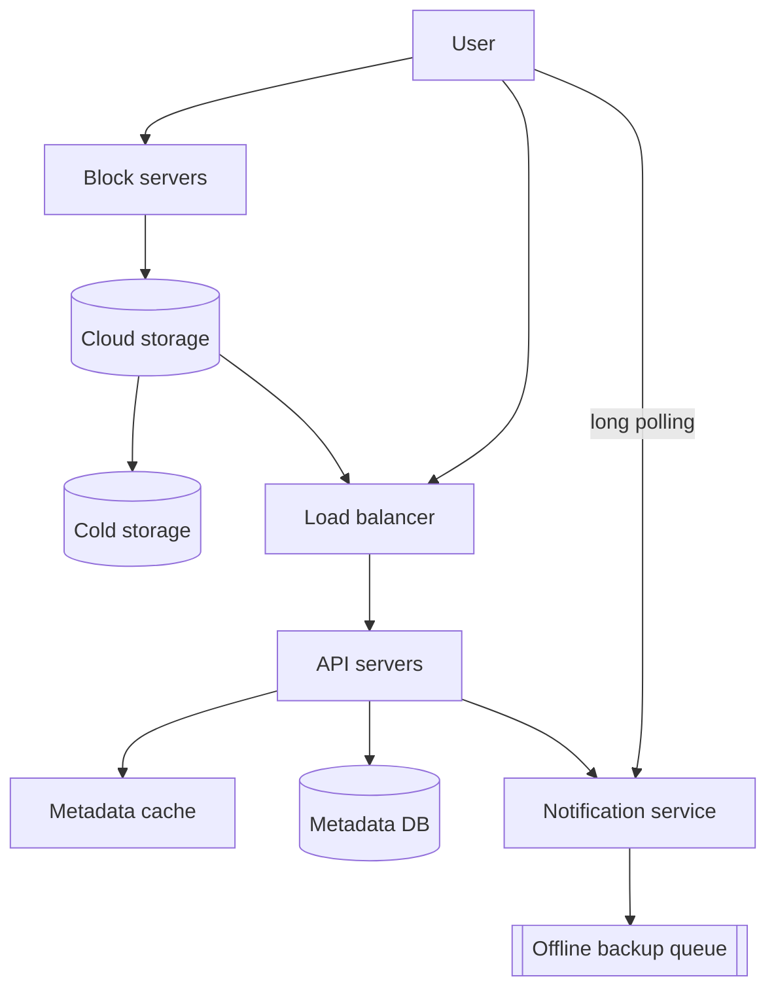
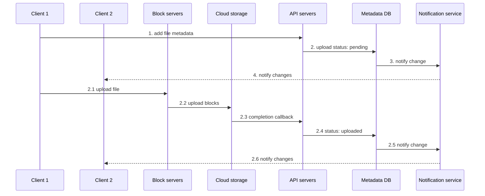
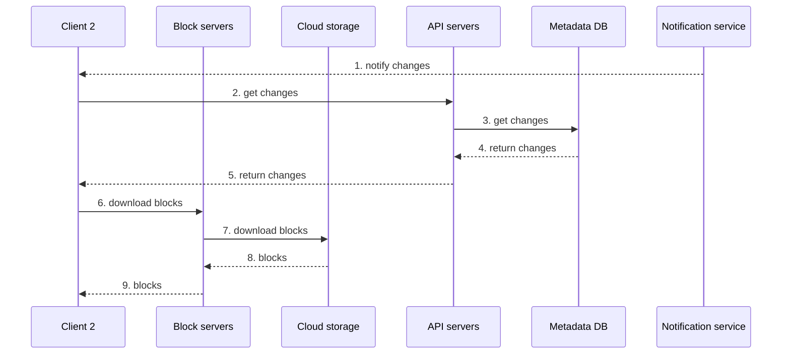

# Chapter 15: Design Google Drive

## Core Idea
Grow from one server to a decoupled design: **block servers** split files into ≤ 4 MB blocks, compress, encrypt, and upload only changed blocks (delta sync) to cloud storage (S3, cross-region replicated); a **strongly consistent relational metadata DB** tracks files, versions, and blocks; a **long-polling notification service** tells other clients to pull changes; an offline backup queue covers disconnected clients.

## Frameworks Introduced
- **Start single-server, then scale**: Apache + MySQL + `drive/` namespaces → disk full → shard by `user_id % 4` → move files to S3 (same-/cross-region replication) → add LB, more web servers, external replicated/sharded metadata DB.
- **Three APIs**: upload (simple or **resumable**) · download · list revisions. All authenticated over HTTPS/SSL.
- **Resumable upload (3 steps)**: request resumable URL → upload data and monitor state → resume if disturbed.
- **Sync conflict rule**: first version processed wins; later one gets a conflict — show both (local + server copy) and let the user merge or override.
- **Block server pipeline**: split → compress (gzip/bzip2 for text; others for media) → encrypt → upload. **Delta sync**: only modified blocks transfer.
- **Upload flow (parallel)**: *add metadata* (1 add → 2 status "pending" → 3 notify → 4 notify client 2) ‖ *upload file* (2.1 to block servers → 2.2 blocks to cloud storage → 2.3 completion callback to API → 2.4 status "uploaded" → 2.5–2.6 notify).
- **Download flow (9 steps)**: notified → get changes from API → metadata DB → return → download blocks via block servers from cloud storage → reconstruct.
- **Save storage**: dedupe blocks by hash (per account) · version limits / keep valuable (recent-weighted) versions · move cold data to S3 Glacier.

## Key Concepts
- **Namespace**: a user's root directory; file ID = namespace + relative path.
- **Block**: independently stored object with a unique hash; Dropbox max 4 MB; files rebuilt by joining blocks in order.
- **Cold storage**: cheap storage for data inactive for months/years.
- **Strong consistency**: required — a file must never look different to different clients. Cache replicas consistent with master; **invalidate cache on DB write**. Relational DB chosen for native **ACID** (NoSQL would need it in code).
- **Offline backup queue**: holds changes for offline clients.
- **Long polling** for notifications (Dropbox's choice): one-directional, infrequent, no bursts — WebSocket is overkill.

## Mental Models
- Reliability first: **data loss is unacceptable** → replicate everything, across regions.
- Bandwidth is a user-facing cost (mobile plans) → **delta sync + compression**.
- Put chunk/compress/encrypt logic **server-side in block servers**: one implementation instead of iOS/Android/Web copies, and clients can be tampered with.
- File-version rows are **immutable** to preserve history integrity.

## Anti-patterns
- **Single server / single region** storage.
- **Re-uploading whole files on each edit**.
- **Eventually consistent caches for file metadata**.
- **Client-side encryption logic** (hackable, duplicated across platforms) — though direct-to-cloud upload is faster.
- **Keeping every revision forever** of a heavily edited file.

## Code Examples
```text
POST https://api.example.com/files/upload?uploadType=resumable   (data: local file)
GET  https://api.example.com/files/download        {"path": "/recipes/soup/best_soup.txt"}
GET  https://api.example.com/files/list_revisions  {"path": "/recipes/soup/best_soup.txt", "limit": 20}
```

## Reference Tables

**Back-of-envelope**

| Quantity | Value |
|---|---|
| Signed up / DAU | 50 M / 10 M |
| Free space | 10 GB per user |
| Uploads | 2 files/user/day, avg 500 KB; read:write 1:1 |
| Total allocated | 50 M × 10 GB = **500 PB** |
| Upload QPS | 10 M × 2 / 86,400 ≈ **240**; peak **480** |

**Scope**: upload/download, sync, notifications · mobile + web · any file type · encrypted at rest · ≤ 10 GB per file · 10 M DAU. Features: add (drag & drop), download, multi-device sync, revisions, sharing, notifications on edit/delete/share. Out of scope: Google Docs collaborative editing. Non-functional: reliability, fast sync, low bandwidth, scalability, HA.

**Fig 15-13 — Metadata schema**

| Table | Key fields |
|---|---|
| user | user_id, user_name, created_at |
| device | device_id (uuid), user_id, last_logged_in_at (push_id for mobile push) |
| workspace (namespace) | id, owner_id, is_shared, created_at |
| file | id, file_name, relative_path, is_directory, latest_version, checksum, workspace_id, created_at, last_modified |
| file_version | id, file_id, device_id, version_number, last_modified (read-only rows) |
| block | block_id, file_version_id, block_order |

Relations: user 1–* device, user 1–* workspace, workspace 1–* file, file 1–* file_version, file_version 1–* block.

**Failure handling**

| Failure | Response |
|---|---|
| Load balancer | secondary takes over (heartbeat between LBs) |
| Block server | others pick up pending jobs |
| Cloud storage | fetch from another region's replica |
| API server | stateless → LB reroutes |
| Metadata cache | replicated; replace node |
| Metadata DB master / slave | promote slave / read from another slave |
| Notification service | clients reconnect elsewhere — slow (Dropbox: > 1 M connections per machine) |
| Offline backup queue | replicated; consumers re-subscribe to backup |

## Diagrams

**Fig 15-1/15-2**: Drive web and mobile UIs (folders Recipes, Salad, Soup; docs).

**Fig 15-3**: `drive/` → `user1/{recipes/, chicken_soup.txt}`, `user2/{football.mov, sports.txt}`, `user3/{best_pic_ever.png}`.

**Fig 15-4**: `/drive` — 10 MB free of 1 TB. **Fig 15-5**: `user_id % 4` → Server1–4.

**Fig 15-6**: bucket replicated ×3 within Region A (same-region) vs Region A → Region B (cross-region).

**Fig 15-7**: User → LB → API servers → metadata DB + file storage.

**Fig 15-8/15-9 — Sync conflict**: user 1 and user 2 upload simultaneously; user 1 processed first → "synced"; user 2 → "conflict"; UI shows `SystemDesignInterview` and `SystemDesignInterview_user 2_conflicted_copy_2019-05-01`.

**Fig 15-10 — High-level design**


**Fig 15-11 — Block server**: file → split into Block 1…N → compress → encrypt → cloud storage.

**Fig 15-12 — Delta sync**: blocks 1–10; only changed blocks 2 and 5 go to cloud storage.

**Fig 15-14 — Upload sequence**


**Fig 15-15 — Download sequence**


## Worked Example
**Edit a 40 MB file on a laptop while the phone is offline**:
1. Client splits into 10 × 4 MB blocks; blocks 2 and 5 changed (hash mismatch) → only those go to block servers, which compress, encrypt, upload to S3 (replicated cross-region).
2. In parallel, metadata request creates a new `file_version` row (status pending → uploaded on S3 callback); block rows point to 8 unchanged + 2 new blocks; metadata cache invalidated on write.
3. Notification service closes the laptop's other sessions' long polls → they fetch metadata and download 2 blocks. The phone is offline → change recorded in the offline backup queue; on reconnect it pulls the same delta.
4. Same file edited 1,000 times today → keep a capped set of recent-weighted versions; after months idle, move to Glacier.

## Key Takeaways
1. Evolve from a single server; show why each piece (sharding, S3, LB, external DB) appears.
2. Block servers: chunk (≤ 4 MB), compress, encrypt, delta-sync.
3. Strong consistency for metadata: relational DB (ACID) + invalidate cache on write.
4. Long polling for notifications; offline queue for disconnected clients.
5. First-processed-wins conflicts; present both copies.
6. Save space: block dedupe, version limits, cold storage.
7. Alternatives to discuss: direct client-to-cloud upload (faster, but duplicated + insecure client logic); separate presence service.

## Connects To
- **Ch 1**: sharding, replication, LB, stateless API tier.
- **Ch 12**: long polling vs WebSocket trade-off; presence service.
- **Ch 14**: blob storage, resumable chunked upload.
- **Ch 6**: consistency models; Ch 10 notification patterns.
